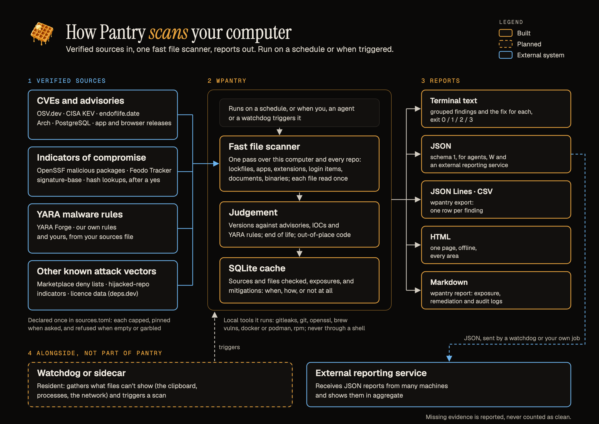

# Pantry

Waffuru's security vulnerability scanner, built on the OSV database and other CVE sources. Its command is `wpantry`.



[Full size](docs/images/architecture.png) · [SVG](docs/images/architecture.svg) · [How it works](docs/architecture.md)

Pantry finds the vulnerabilities that actually apply to your computer. It inventories what is installed and what your git repos lock, asks [OSV.dev](https://osv.dev), [CISA KEV](https://www.cisa.gov/known-exploited-vulnerabilities-catalog) and [endoflife.date](https://endoflife.date) only about those exact versions, and fails only when something here has a known vulnerability with a released fix, is past end of life, is a known malicious package, or is a committed secret. Answers live in a local SQLite cache, so a second run the same day takes seconds. Nothing that isn't installed is reported, and a source it can't reach is reported "not checked", never clean.

| What you get | What it checks |
|---|---|
| Know which installed things need updating, and the exact safe version | Runtimes and compilers (every version managers keep, not just PATH), package managers, CLI tools, datastores, Docker, global pip/npm/gem/cargo/pipx packages, Homebrew formulae (`brew vulns`, or read from the Cellar where mise poured them without `brew`); mise itself against OSV and its latest release (behind warns; `--fix` never updates it) |
| Catch vulnerable dependencies before they ship | Lockfiles in every git repo: Cargo, npm, pnpm, yarn, bun, deno, Swift, Go, uv, poetry, pip, Bundler, Composer, Maven, Gradle, NuGet and more |
| Catch malware, not just CVEs | YARA rules (ours and YARA Forge's 12,000) over Downloads, Desktop, temp directories, login items and repo programs (`--deep`: all of `~`); every package name against the OpenSSF malicious-packages index; VS Code's malicious-extension list |
| Find leaked credentials in history | Secrets committed anywhere in each repo's git history (`gitleaks`) |
| See what your AI coding tools actually run | Claude Code, Codex, Cursor, Gemini CLI and other harnesses: their MCP servers (unpinned ones warn), plugins, skills and bundled npm packages |
| Keep the OS, browsers and apps current | macOS Software Update, Debian/Ubuntu/Alpine/openSUSE packages, dnf distros, Arch; Chrome, Firefox; Electron apps; other apps against the Homebrew cask catalog |
| Know when a runtime stops getting fixes | End-of-life dates for runtimes and datastores |
| Know whether the machine itself is set up safely | FileVault or LUKS, the firewall, Gatekeeper and SIP, automatic updates, Remote Login and the sharing services, guest and automatic login, the screen lock (CIS benchmark items, read-only; `--no-posture` skips them) |
| Know what runs at login, and what is new since last time | Launch agents and daemons, login items, cron, at, kernel and system extensions, authorization, Quick Look and Spotlight plugins, systemd units, autostart entries and the shells' startup files, compared with the last scan's list; library injection (`DYLD_INSERT_LIBRARIES`, `LD_PRELOAD`), broken code signatures and programs in hidden places warn every time |
| Spot a compromised certificate authority | System, OpenSSL, Homebrew, certifi, pip and Node trust stores against the leaked eMudhra CAs (`wpantry harden ca-trust` distrusts them) |
| Review supply-chain risk | Dependency licenses outside an allowlist, npm install scripts, container images your repos build from |
| Know whether a clipper is swapping wallet addresses | A valid address of each shape (EVM, Bitcoin, Tron, Solana, XRP, Stellar) copied to the clipboard and read back; launch agents and autostart entries that touch the clipboard with wallet addresses in hand; browser extensions and repos with the clipper shape (`--no-clipboard` skips the copy); a resident guard that alerts the moment a copied address is swapped (`wpantry clipboard --watch`, `wpantry schedule install --clipboard-guard`) |
| Catch code that behaves like an attack | Decoded-then-executed strings, payload arrays, decoders, `sudo` and persistence in install scripts, credential theft, crypto-wallet signing, drainers and account takeovers on Ethereum, Tempo, Solana, Stellar, XRP and Tron, clipboard clippers, unpinned third-party scripts, in the repos and in every editor, agent and browser extension installed; harsher where the pattern is out of place for its language, warn elsewhere, with a policy file that downgrades but never silences |
| See text the way a parser sees it | Bidi overrides (Trojan Source), invisible tag and zero-width characters that hide instructions from you but not from an AI assistant, mixed-script identifiers, and weapon-vocabulary identifiers meant to make an AI reviewer refuse the file |
| Don't get owned by opening a clone | Hooks a repo runs on open or install (Claude Code, Gemini, MCP servers in the repo, VS Code folder-open tasks, devcontainers, direnv, `postinstall`, gyp, native addons) and the indicators of known hijacked-repo campaigns |
| Fix it, safely | `wpantry fix` runs only unattended, user-level fixes and, after a yes, the stopgaps wpantry has for advisories with no fix yet (`wpantry mitigate`); everything else needing sudo or a code change is printed as a step |

Every check, every source it asks and exactly what is sent to each: [docs/public/checks-and-sources.md](docs/public/checks-and-sources.md).

## Install

```bash
mise use -g packslip:github.com/waffuruai/pantry                                 # with mise (the default)
curl -fsSL https://github.com/waffuruai/pantry/releases/latest/download/install.sh | sh  # without mise
```

Both verify the release before installing: mise against the release's signed packslip, and `install.sh` against `SHA256SUMS` and a signature (packslip, `gh` or `cosign`, whichever you have). [docs/public/install.md](docs/public/install.md) has the details, manual verification, crates.io and building from source. Releases cover macOS (one binary for Apple silicon and Intel) and Linux (x86-64 and arm64, static); Windows: [#11](https://github.com/waffuruai/pantry/issues/11). Homebrew: [#10](https://github.com/waffuruai/pantry/issues/10).

`wpantry tools` lists the external tools it uses (`git`, `gitleaks`, `openssl`; `brew` and `docker` when present) and which are missing.

## Usage

```bash
wpantry scan                                       # this computer: machine + every git repo under ~
wpantry scan --path ~/code/myproject --no-machine  # one project, no machine inventory
wpantry scan --json --no-input                     # findings for tools and agents
wpantry search "tarfile" --applicable              # ranked search of cached advisories
wpantry export --csv findings.csv                  # id, url, component, affected and safe version
wpantry watch                                      # re-ask about the unfixed Critical/High advisories; exit 10 when a fix landed
wpantry fix --dryrun                               # the update plan, change nothing
wpantry fix                                        # apply the unattended fixes, then re-check
wpantry help                                       # every command (wpantry help fix for one)
```

Exit codes: 0 clean (warnings included), 1 something fails, 2 usage error, 3 internal error, 10 (`update --check`, `watch`) a newer release exists or a fix has landed. `wpantry update` checks for a newer release and installs it verified (`--check` only asks).

**Scope.** By default wpantry checks the machine and every git repo it finds under your home directory, with a bounded walk (depth 6, no symlinks, skipping `Library`, caches, toolchains, `node_modules` and app bundles; it prints how many repos it found). `--path DIR` (repeatable) limits the repo checks to those directories; `--no-machine` skips the machine inventory. Policy files default to the bundled ones in [`rust/crates/wpantry/assets/defaults/`](rust/crates/wpantry/assets/defaults/) and can be replaced with `--gitleaks-config`, `--install-scripts`, `--repo-hooks`, `--suspect-policy`, `--posture-policy` and `--hooks-policy` (the repo hooks you have read and accept). Dependency licenses are not checked unless you pass `--licenses` (the bundled allowlist) or `--licenses FILE`; `--license` works too.

**Cache.** `~/.cache/wpantry/wpantry.db` (or `$XDG_CACHE_HOME/wpantry/`, or `WPANTRY_DB`). It holds only OSV records for what is here, which versions were checked and when, the latest findings and the side feeds; never a mirror of OSV.

**What leaves the machine.** Package names and versions go to OSV.dev; feeds are fetched; the binary connects to no host outside a compiled-in list, over TLS your machine's trust store verifies. The optional email breach check sends your address to Have I Been Pwned (`HIBP_API_KEY`) or XposedOrNot, and only after you say yes. Source by source: [docs/public/checks-and-sources.md](docs/public/checks-and-sources.md#sources).

**Agents.** `wpantry skill` prints the agent skill ([rust/crates/wpantry/assets/SKILL.md](rust/crates/wpantry/assets/SKILL.md)).

**Output.** On a terminal the report is coloured (failures red, warnings yellow, what's fine green) and questions are `y/n` prompts; `NO_COLOR` turns colour off, and pipes, files and `--json` never get it.

## Docs

- [Install and verify a release](docs/public/install.md), [use wpantry](docs/public/usage.md), [what it checks and its sources](docs/public/checks-and-sources.md), and [the machine's settings it checks](docs/public/posture.md).
- [How it works](docs/architecture.md): the picture and a run in five steps; the detail is [docs/internal/architecture.md](docs/internal/architecture.md).
- For maintainers: the [release playbook](docs/internal/release.md), [publishing to crates.io](docs/internal/crates-io.md) and [dependency rules](docs/internal/dependencies.md).

## Development

```bash
mise bootstrap   # the pinned tools, then build wpantry and run `wpantry tools` to confirm them
mise run test    # the Rust tests, the CA trust test and the install.sh test, offline
```

`mise tasks ls` lists the rest: `mise run build`, `mise run test rust`, `mise run test ca-trust`, `mise run test install`, `mise run lint`, `mise run contract` (the CLI contract suite against `WPANTRY`, default the binary `build` makes), and `mise run scan` (`wpantry scan` with the pinned tools; flags after `--`). The code is in `rust/` ([rust/README.md](rust/README.md) maps the source; [docs/architecture.md](docs/architecture.md) is how it works); the standalone CA trust check and fix are in `ca-trust/`; the stopgaps for advisories that have no fix to install yet are in the binary (`wpantry mitigate <ID>`, [docs/public/usage.md](docs/public/usage.md#advisories-with-no-fix-yet)).

The CLI contract wpantry keeps is [specs/cli-contract.md](specs/cli-contract.md); the specs, current and archived, are indexed in [specs/](specs/README.md). See [CONTRIBUTING.md](CONTRIBUTING.md) and [SECURITY.md](SECURITY.md).

## Acknowledgements

Pantry stands on open source code and open data. The code we read and wrote against:

- [osv-scanner](https://github.com/google/osv-scanner) and [osv-scalibr](https://github.com/google/osv-scalibr) (Google, Apache-2.0): how lockfiles and Linux package databases map to OSV ecosystems. wpantry's readers were written against their test fixtures, and the Python implementation ran osv-scanner itself before the Rust port.
- [Mergen](https://github.com/sametsazak/mergen) (MIT): which macOS security settings an unprivileged process can read and fix, behind the posture checks.
- [gitleaks](https://github.com/gitleaks/gitleaks) (MIT): the secret scan, run as an external tool with our bundled rules.
- [YARA](https://github.com/VirusTotal/yara) and [YARA-X](https://github.com/VirusTotal/yara-x) (VirusTotal, BSD-3-Clause): the rule language the malware scan reads. Our engine, [wpantry-yara](rust/crates/wpantry-yara), is written here; it follows YARA's semantics and adopts YARA-X's stricter rules for our own rules, and was tested match-for-match against YARA 4.5.7. Ideas for the scanner came from Florian Roth's [Loki-RS](https://github.com/Neo23x0/Loki-RS), [yarGen](https://github.com/Neo23x0/yarGen-Go) and [signature-base](https://github.com/Neo23x0/signature-base); no code was copied.

The data it asks, each under its publisher's terms:

- [OSV.dev](https://osv.dev) and the [OSV schema](https://ossf.github.io/osv-schema/) (Google and the OpenSSF): the vulnerability database behind every package question, aggregating the GitHub Advisory Database, RustSec, PyPA, the Go vulnerability database and the distributions' own trackers.
- [CISA Known Exploited Vulnerabilities](https://www.cisa.gov/known-exploited-vulnerabilities-catalog): the `KEV` mark.
- [endoflife.date](https://endoflife.date) (MIT): end-of-life dates.
- [OpenSSF malicious-packages](https://github.com/ossf/malicious-packages) (Apache-2.0): known malicious package names.
- [deps.dev](https://deps.dev), the [Homebrew](https://brew.sh) formulae API and `brew vulns`, the [Arch Linux security tracker](https://security.archlinux.org), the Chrome and Firefox release feeds, the PostgreSQL security page, the VS Code Marketplace and [Open VSX](https://open-vsx.org), [Have I Been Pwned](https://haveibeenpwned.com) and [XposedOrNot](https://xposedornot.com).
- [signature-base](https://github.com/Neo23x0/signature-base)'s IOC lists (Florian Roth, Detection Rule License 1.1): known-bad hashes, malware file names and C2 hosts; [abuse.ch](https://abuse.ch)'s Feodo Tracker (CC0), YARAify (CC0) and MalwareBazaar, and [CIRCL hashlookup](https://hashlookup.circl.lu): the lists and the opt-in hash lookups for flagged files.
- [YARA Forge](https://github.com/YARAHQ/yara-forge) (Florian Roth and Arnim Rupp): the community YARA rules the malware scan fetches to your machine, collected from 40+ projects under each rule's own license (signature-base's under the [Detection Rule License](https://github.com/Neo23x0/signature-base/blob/master/LICENSE), ReversingLabs' under MIT, and more; each rule's `author`, `reference` and `license` meta say whose it is). Pantry downloads them; it doesn't redistribute them.
- The [CIS Benchmarks](https://www.cisecurity.org/cis-benchmarks) for macOS and Linux, which the posture checks follow, and the [eMudhra advisory](https://emudhra.we-have-a-problem.com/), which the certificate-authority check follows.

And the Rust crates it is built from, pinned in [rust/Cargo.toml](rust/Cargo.toml) under their own permissive licenses: serde and serde_json, rusqlite (SQLite), ureq and rustls. The YARA engine adds none.

## License

[MIT](LICENSE).
