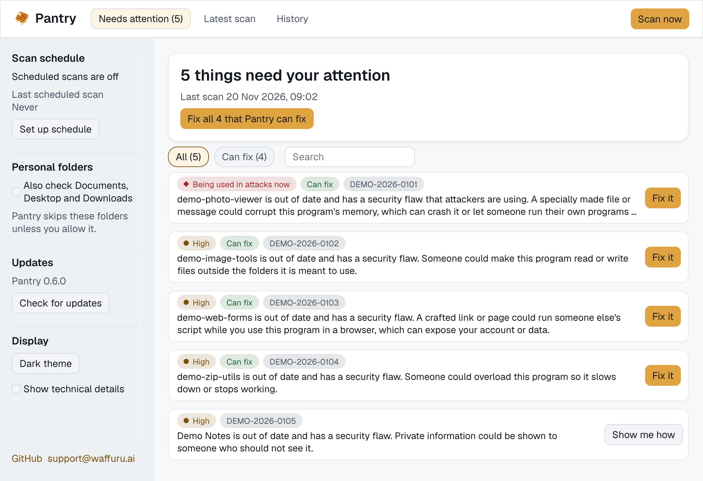

# Pantry

Waffuru's vulnerability scanner for your computer and your code. It finds what actually applies to this machine, not everything that might. The command is `wpantry`.


Pantry Desktop is the app for people who would rather not use the command line; the [Pantry Desktop guide](docs/public/desktop.md) shows how it works.


[Full size](docs/images/architecture.png) · [SVG](docs/images/architecture.svg) · [How it works](docs/public/architecture.md)

## What it does

| | |
|---|---|
| **Patch what's exposed** | Checks only the versions installed or locked here: runtimes, packages, apps, browsers, the OS and every repo's lockfiles. Each finding has a severity, its CVSS score, its EPSS exploit likelihood and CISA's known-exploited mark. |
| **Catch malware** | Malware rules from YARA Forge, plus known-bad hashes, hosts and malicious packages. |
| **Stop supply-chain attacks** | Hooks a cloned repo runs on open, npm install scripts, typosquats, and code that steals credentials or swaps wallet addresses. |
| **Find leaked secrets** | Credentials committed anywhere in a repo's git history. |
| **See what your AI tools run** | The MCP servers, plugins and skills of Claude Code, Codex, Cursor and others. |
| **Harden the machine** | CIS checks of disk encryption, the firewall, sharing and login, programs that start at login, and compromised certificate authorities. |
| **Fix it safely** | `wpantry fix` runs only unattended, user-level updates. Anything else is printed as a step for you or your agent to run. |
| **Prove it** | Exposure, remediation and audit logs, and a one-page summary for SOC 2, ISO 27001 and insurers. |

Every check, every source and exactly what is sent to each: [checks and sources](docs/public/checks-and-sources.md).

> **Looking after a fleet of computers, or running a business?** We can make keeping them all patched and checked easier. [Check out our other tools](https://waffuru.ai).

## Install

**Pantry Desktop**, the app with a window: download Pantry Setup for your computer from the [latest release](https://github.com/waffuruai/pantry/releases/latest) and open it. [Download Pantry Setup](docs/public/install.md#download-pantry-setup) covers each platform and the warning macOS and Windows show for an app that is not yet signed. To build it from this repository instead, see [Build it yourself](docs/public/install.md#build-it-yourself).

**The `wpantry` command:**

```bash
curl -fsSL https://github.com/waffuruai/pantry/releases/latest/download/install.sh | sh  # recommended
mise use -g packslip:github.com/waffuruai/pantry                                        # with mise, once it is installed and activated
```

Both verify the release before installing anything. New to mise? [Install](docs/public/install.md#install-the-command-line-scanner) shows how to set it up first. To verify a release by hand, upgrade, uninstall, or install from crates.io or source, see [install](docs/public/install.md). Releases cover macOS (Apple silicon and Intel), Linux (x86-64 and arm64) and Windows x86-64 (repo checks, and the installed programs Pantry's program table names against CVE records; the rest of the machine inventory is [#11](https://github.com/waffuruai/pantry/issues/11)).

## Desktop

Pantry Desktop shows what needs attention, fixes what it can after you say yes, and sets up scheduled scans, in a window on macOS, Linux and Windows. It runs the same scanner and shares its results with the `wpantry` command. Read the [Pantry Desktop guide](docs/public/desktop.md); for building, testing and automating the app, see [desktop/README.md](desktop/README.md).



## Use

```bash
wpantry scan                              # this computer and every git repo under ~
wpantry scan --path ~/code/app            # one project
wpantry report --html                     # the latest scan as one offline page
wpantry report summary --md               # one page for a CSO or an auditor
wpantry fix --dry-run                     # the update plan; changes nothing
wpantry fix                               # apply the unattended fixes, then re-check
wpantry schedule install --every week     # scan every Monday
wpantry help                              # every command
```

Exit codes: 0 clean, 1 something fails, 2 usage error, 3 internal error. For everything else, see [usage](docs/public/usage.md).

## Privacy

Pantry sends no usage telemetry. Scan results, fix history and reports stay on your computer. Online scans contact advisory sources, which may receive lookup details such as package names and versions. Use `wpantry scan --offline` to scan from cached data. [See what each source receives.](docs/public/checks-and-sources.md#sources)

## Docs

- [Install](docs/public/install.md), [Pantry Desktop](docs/public/desktop.md), [usage](docs/public/usage.md), [reports](docs/public/reports.md), [checks and sources](docs/public/checks-and-sources.md), [machine settings](docs/public/posture.md), [malware](docs/public/malware.md)
- [How it works](docs/public/architecture.md)
- For agents: `wpantry skill` prints the [agent skill](rust/crates/wpantry/assets/SKILL.md)
- For maintainers: [release](docs/internal/release.md), [crates.io](docs/internal/crates-io.md), [dependencies](docs/internal/dependencies.md), [CLI contract](specs/cli-contract.md)

## Develop

```bash
mise bootstrap    # the pinned tools, then build wpantry
mise run test     # every test, offline
mise tasks ls     # the rest: build, lint, contract, coverage, notices, scan
```

The code is in [`rust/`](rust/README.md). See [CONTRIBUTING.md](CONTRIBUTING.md) and [SECURITY.md](SECURITY.md).

## Acknowledgements

Code we read and built on:

- [osv-scanner](https://github.com/google/osv-scanner) and [osv-scalibr](https://github.com/google/osv-scalibr) (Google, Apache-2.0): how lockfiles and Linux package databases map to OSV ecosystems. Pantry's readers were written against their test fixtures.
- [Mergen](https://github.com/sametsazak/mergen) (MIT): which macOS settings an unprivileged process can read and fix.
- [betterleaks](https://github.com/betterleaks/betterleaks) (MIT): the secret rules Pantry's scanner runs, translated to YARA in [pantry-rules](https://github.com/waffuruai/pantry-rules).
- web2, Webster's Second International (public domain): the words the secret scan's readable-text check knows.
- [FIRST's CVSS v4.0 calculator](https://github.com/FIRSTdotorg/cvss-v4-calculator) (BSD-2-Clause, Copyright (c) 2023 FIRST.ORG, Inc., Red Hat, and contributors): CVSS 4.0 scoring in [`cvss.rs`](rust/crates/wpantry/src/utils/cvss.rs) ports its lookup table and scoring; the licence is kept in that file.
- [YARA](https://github.com/VirusTotal/yara) and [YARA-X](https://github.com/VirusTotal/yara-x) (VirusTotal, BSD-3-Clause): the rule language. Our engine, [wpantry-yara](rust/crates/wpantry-yara), is written here and tested match-for-match against YARA 4.5.7. Ideas came from Florian Roth's [Loki-RS](https://github.com/Neo23x0/Loki-RS), [yarGen](https://github.com/Neo23x0/yarGen-Go) and [signature-base](https://github.com/Neo23x0/signature-base); no code was copied.

Data it asks, each under its publisher's terms:

- [OSV.dev](https://osv.dev) and the [OSV schema](https://ossf.github.io/osv-schema/) (Google and the OpenSSF), aggregating the GitHub Advisory Database, RustSec, PyPA, the Go vulnerability database and the distributions' trackers.
- [CISA Known Exploited Vulnerabilities](https://www.cisa.gov/known-exploited-vulnerabilities-catalog).
- [CVE®](https://www.cve.org) (The MITRE Corporation, under the [CVE Terms of Use](https://www.cve.org/Legal/TermsOfUse)), with the scores CISA adds to CVE records. CVE is a registered trademark of The MITRE Corporation.
- [EPSS](https://www.first.org/epss/) (FIRST; scores published daily by Empirical Security).
- [CIRCL Vulnerability-Lookup](https://vulnerability.circl.lu): CVE records indexed by vendor and product, for installed software no package ecosystem covers.
- [endoflife.date](https://endoflife.date) (MIT) and [OpenSSF malicious-packages](https://github.com/ossf/malicious-packages) (Apache-2.0).
- [deps.dev](https://deps.dev), the [Homebrew](https://brew.sh) formulae API and `brew vulns`, the [Arch Linux security tracker](https://security.archlinux.org), the Chrome and Firefox release feeds, the PostgreSQL security page, the VS Code Marketplace, [Open VSX](https://open-vsx.org), [Have I Been Pwned](https://haveibeenpwned.com) and [XposedOrNot](https://xposedornot.com).
- [signature-base](https://github.com/Neo23x0/signature-base)'s IOC lists (Florian Roth, Detection Rule License 1.1); [abuse.ch](https://abuse.ch)'s Feodo Tracker (CC0), YARAify (CC0) and MalwareBazaar; [CIRCL hashlookup](https://hashlookup.circl.lu).
- [YARA Forge](https://github.com/YARAHQ/yara-forge) (Florian Roth and Arnim Rupp): community rules from 40+ projects, each under its own license (see each rule's `author`, `reference` and `license` meta). Pantry downloads them to your machine; it doesn't redistribute them.
- The [CIS Benchmarks](https://www.cisecurity.org/cis-benchmarks) for macOS and Linux, and the [eMudhra advisory](https://emudhra.we-have-a-problem.com/).

Rust crates, pinned in [rust/Cargo.toml](rust/Cargo.toml) under their own permissive licenses: serde, serde_json, rusqlite (SQLite), ureq and rustls.

## License

[MIT](LICENSE). The licences and notices of everything third-party built into the binary travel with it: `wpantry licenses` prints them, and each release ships them as `THIRD-PARTY-NOTICES.txt`.
