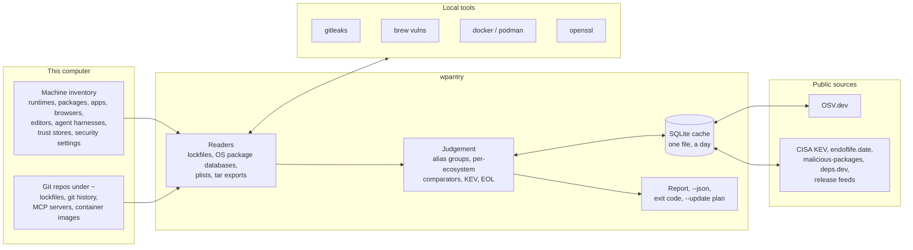
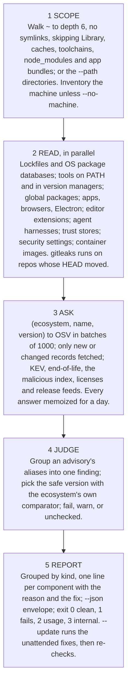

# How wpantry works

wpantry is one Rust binary that inventories a computer and its git repos, asks a few public sources about exactly those versions, and reports what has a known fix, is past end of life, is malicious, is a leaked secret, or is a setting that leaves the machine open. This page is how it is put together. What it checks and which sources it asks are in [public/checks-and-sources.md](public/checks-and-sources.md); how to run it is [public/usage.md](public/usage.md); the surface it promises to keep is [specs/cli-contract.md](../specs/cli-contract.md); the source files are mapped in [rust/README.md](../rust/README.md).

## What it is, and is not

A library crate, `wpantry`, and a thin binary, `wpantry-cli`. The library has no global state and never prints; the CLI owns stdout, stderr and the exit codes. Embedders depend on the library at an exact `0.x` version and accept breakage between minors; the [CLI contract](../specs/cli-contract.md) is the only stable surface, and the contract suite runs the binary rather than reading its internals.

It is not SAST, reachability analysis, guided remediation, an SBOM reader or an offline OSV mirror, and it does not port gitleaks or `brew vulns`: those run as external tools. Windows is [#11](https://github.com/waffuruai/pantry/issues/11).

## A run

**Scope.** `repos::walk` finds the git repos (and, with `--path`, scans a directory without one as a single project). Build output and dependency directories are skipped everywhere a walk happens.

**Read.** Almost nothing in a run is CPU: it waits on subprocesses (tool versions, npm, Python, openssl, gitleaks, Homebrew) and on HTTP. So independent probes run at once (`system::par_map`, results kept in order), the trust stores and Software Update run beside the inventory, gitleaks scans stale repos while the dependency checks wait on the network, the HTTP pool keeps a connection per parallel fetch, and folders are read where a command would only list them (the Homebrew Cellar and Caskroom, `npm root -g`). On 2026-10-28 a warm run over the org workspace on a developer Mac took 4 to 5 s and a cold one 136 to 149 s; in Linux containers a warm run takes 1 to 3 s. A cold run's floor is the network and exporting container images; a warm run's is npm and the tool probes.

**Ask.** The OSV client posts `querybatch` with at most 1000 queries per request and follows `next_page_token` per query; a record is fetched (`GET /v1/vulns/{id}`, at most 8 in flight, `If-None-Match` with the stored ETag) only when its id is new or its `modified` time changed. Answers are cached per (ecosystem, name, version) for a day; failures are never cached. The feeds go through the same memo: a key, a time to live, and a fingerprint of the input, so a cached result is reused offline or after a failure only for the same input (a changed repo HEAD, Homebrew listing or image gets a fresh answer).

**Judge.** Records are grouped by id, aliases and upstream CVE, so one vulnerability from two databases is one finding, named by its bare CVE when a record carries one. The fix a finding recommends is the version that repairs every record in the group, ordered by the ecosystem's own comparator. OSV decides whether a version is affected; wpantry only orders fixed versions to pick the safe one and to compare against "latest".

**Report.** Failures are a released fix, end of life, a malicious package, a committed secret from a provider-specific rule, or a Critical or High posture setting. Warnings are no fix yet, an outdated app, an unpinned MCP server, an install script, a generic secret rule, a Medium or Low posture setting. "Not checked" is a source that couldn't be reached and had nothing cached, or a file that couldn't be read.

## Missing evidence is never clean

The rule every module follows: when wpantry cannot tell, it says so, and never lets the gap make the result look better.

- A missing tool fails (`MISSING`); an unreachable source warns (`unchecked`). An OSV answer older than a day that couldn't be refreshed, and an advisory OSV names but can't serve, are reported unchecked while the findings they do give still stand; an advisory OSV changed but can't serve keeps its old record, which still counts, and is reported until the new revision arrives. A `querybatch` answer that isn't an object, or whose `vulns` isn't a list of advisories with ids, is an error, not "no advisories", and never replaces an earlier answer.
- A malicious-package report that can't be fetched is reported unchecked and asked again next run; nothing is made up for it.
- A lockfile that isn't the format it is named as (no `lockfileVersion`, no `module` line, a `packages` that isn't the section npm or pnpm writes), or that links outside its repo, is reported unchecked instead of read as empty. `npm-shrinkwrap.json` is read, and wins over a `package-lock.json` beside it, as npm does.
- A trust store openssl can't load is unchecked, not "doesn't trust the distrusted CAs"; `PIP_CERT`, when set, is pip's store and is judged like any other. A posture check that can't tell is reported as such, never as a pass.
- A gitleaks run that leaves no report, or one that isn't a list of findings, is a failed run (unchecked), never a repo with no secrets; only `[]` is none.
- A Python distribution whose metadata is missing, unreadable or names no version is a gap in that interpreter's packages, reported unchecked, never a package that isn't installed.
- An advisory whose only fixes are older than the installed version (it came back in a later release) counts as unfixed, not as a fix that would be a downgrade.
- A container export cut short is an error, not an image with fewer files; an image whose packages can't be read (rpm-based) is unchecked.
- A program that leaves a background process holding its output pipes can't hold the scan past its timeout.
- Every parser is bounded: responses at 128 MiB, JSON depth at 128, lockfiles at 64 MiB and 1 MiB a line, package databases at 256 MiB, each file in an image export at 64 MiB. Over a cap or malformed is unchecked.

## Readers

Lockfiles are read line by line where the format allows and never execute or resolve anything. Each format has golden files cut from real lockfiles, with the expected (ecosystem, name, version) list beside them, in [`rust/crates/wpantry/tests/lockfiles/`](../rust/crates/wpantry/tests/lockfiles/README.md); truncated and mangled copies of every golden file must never panic. Workspace members and local packages (package-lock entries outside `node_modules/`, Cargo packages without a crates.io source, uv's editable and virtual packages, path and `file:` dependencies, Composer `path` repositories, private Hex organizations, Conan `@user/channel` recipes) are not sent to OSV, so a local package that shares a name with a published one can't raise a false finding.

| File | Ecosystem | Formats | Notes |
|---|---|---|---|
| `Cargo.lock` | `crates.io` | v1–v4 | Registry sources only |
| `package-lock.json`, `npm-shrinkwrap.json` | `npm` | v1–v3 | Name from the last `node_modules/` segment; links skipped |
| `pnpm-lock.yaml` | `npm` | v5, v6, v9 | Peer suffixes stripped; an entry's own `name:`/`version:` wins |
| `yarn.lock` | `npm` | v1, berry | Berry's `npm:` and `patch:` resolutions count |
| `bun.lock` | `npm` | JSONC | The binary `bun.lockb` isn't read |
| `deno.lock` | `npm` | v3–v5 | `npm:` entries; `jsr:` has no OSV ecosystem yet; another version is unchecked |
| `Package.resolved` | `SwiftURL` | v1–v3 | The repository URL without scheme or `.git`, as osv-scalibr names it |
| `go.mod` | `Go` | | `require` and `replace`; `toolchain goX`, else `go X`, is the `stdlib` package |
| `uv.lock`, `poetry.lock`, `Pipfile.lock` | `PyPI` | | Editable, virtual, git, directory, file and url sources skipped; names PEP 503-normalized |
| `requirements*.txt` | `PyPI` | | `==` pins only; `-r` includes followed inside the repo, each once |
| `Gemfile.lock` | `RubyGems` | | `GEM` `specs:`; a platform suffix is dropped |
| `composer.lock` | `Packagist` | | `packages` and `packages-dev`; `path` repositories and branches skipped |
| `pubspec.lock` | `Pub` | | `hosted` packages only |
| `mix.lock` | `Hex` | | `:hex` tuples from the public `hexpm` repository |
| `gradle.lockfile`, `pom.xml` | `Maven` | | `pom.xml`: literal versions and same-file properties only, no parent or remote resolution |
| `packages.lock.json` | `NuGet` | v1–v2 | `Project` references skipped |
| `conan.lock` | `ConanCenter` | v0.4–v0.5 | A `@user/channel` recipe is private and skipped |

OS packages are reported under their source package and version, the names OSV matches:

| Source | Read | Package reported |
|---|---|---|
| `/var/lib/dpkg/status` | Stanzas with `Status: install ok installed` | `Source:` (and its version when given), else `Package:` |
| `/lib/apk/db/installed` | `P:`, `V:`, `o:` records | `o:` origin, else `P:` |
| `rpm -qa --qf …` | openSUSE, SUSE | `NAME` |
| dnf advisories, the Arch security tracker | Their own feeds | |

The `os-release` `ID` (never a derivative's `VERSION_ID`, which would name the wrong release) picks the OSV ecosystem string, settled against osv-scalibr's `MakeEcosystem` tests: `Debian:<VERSION_ID>`, `Ubuntu:<VERSION_ID>`, `Alpine:v<major>.<minor>`, `Wolfi`, `Chainguard`, `openSUSE:Leap <VERSION_ID>`, `openSUSE:Tumbleweed`, `SUSE:<VERSION_ID>`. No `VERSION_ID` (Debian testing, say) and anything unmapped is unchecked: a wrong string would come back silently clean.

Container images are `docker|podman create` then `export` into a temp directory, read by a tar reader written here that keeps only the files the readers want, caps each at 64 MiB and ignores entries escaping the root; the same lockfile and OS-database readers run on the result, without layer attribution, and the kernel's source package (present only as headers in a container) is left out. The container and the directory are removed even on error; answers are memoized per image id for 30 days.

The machine inventory finds runtimes and tools on PATH and in every version manager (mise, asdf, pyenv, nvm, volta, uv, rustup, …), global packages (each Python's `site-packages` metadata read under `-I -S`, npm, cargo, pipx, gem), apps and browsers (plists, the Homebrew cask catalog), Electron bundles, pending OS updates, Docker, editor extensions, and the MCP servers, plugins and skills of the coding agents. The trust-store check reads the system, OpenSSL, Homebrew, certifi, pip and Node stores through `openssl`. The posture checks are read-only probes of the settings the CIS benchmarks name ([public/posture.md](public/posture.md)).

## Comparing versions

| Comparator | Used for | Tested against |
|---|---|---|
| semver 2.0 | crates.io, npm, SwiftURL, Pub, Hex, NuGet | semver.org §11 and `x/mod/semver`'s table |
| PEP 440 | PyPI | `packaging`'s version tests |
| Go | Go modules (`v` prefix, pseudo-versions, `+incompatible`) | `golang.org/x/mod/semver` |
| dpkg | Debian, Ubuntu | 656 pairs judged by `dpkg --compare-versions` |
| apk | Alpine, Wolfi, Chainguard | apk-tools' `version.data` (GPL-2.0, so fetched on demand, a selection inline) |
| rpmvercmp | openSUSE, SUSE | rpm's `rpmvercmp.at` |
| RubyGems | RubyGems | rubygems' `test_gem_version.rb` |
| Maven | Maven | maven-artifact's `ComparableVersionTest` |
| Composer | Packagist | composer/semver's parser, comparator and sort tests |
| generic | ConanCenter, upstream release tags, apps, everything else | wpantry's own vectors |

Each is total and never panics; a version its grammar rejects falls back to the generic order.

## The cache

One SQLite file per machine (`~/.cache/wpantry/wpantry.db`, `$XDG_CACHE_HOME`, or `WPANTRY_DB`), FTS5 on, with the tables the [contract](../specs/cli-contract.md#cache-sqlite) fixes: the OSV records for what is here (never a mirror), which versions were asked and when, the latest findings, the side feeds, the malicious-package index, memoized runs with their fingerprints, and `meta` for ETags and bookkeeping. `search` ranks the cached advisories with FTS5; `export` writes them out. A cache outlives releases: schema changes are additive, or bump `schema`.

## The binary

What goes into the binary is reviewed like the code ([internal/dependencies.md](internal/dependencies.md)): five direct dependencies (`serde`, `serde_json` without `derive`, `rusqlite` bundled, `ureq`, `rustls` with `ring`), every one pinned `=x.y.z` and enforced by `tests/pins.rs`, `Cargo.lock` committed, every build `--locked` on the exact toolchain `rust/rust-toolchain.toml` names, `cargo deny` and `cargo vet` gating every merge. Everything else is written here: the lockfile parsers and TOML and YAML line subsets, the comparators, argument parsing, a regex subset, SHA-256, FNV fingerprints, civil dates, the tar and plist readers, the `Net` trait with one `ureq` implementation and one recording fake for tests. `unsafe` is forbidden crate-wide.

A release ([internal/release.md](internal/release.md)) is built from a tag with `lto`, `codegen-units = 1`, `strip`, `--remap-path-prefix` and `SOURCE_DATE_EPOCH` from the commit, twice from two paths, and fails on any difference. Each target ships with `SHA256SUMS`, a GitHub build-provenance attestation and a sigstore bundle, and the release carries a signed packslip; `install.sh` and mise verify them before installing ([public/install.md](public/install.md)). v0.2.0's binaries: 3.5 MiB for aarch64 Linux (musl, static), 4.0 MiB for x86-64 Linux, 6.5 MiB for the macOS universal binary.

Programs run as scanners or data sources are `gitleaks`, `git`, `openssl`, `brew`, `docker` or `podman`, and `rpm`; the inventory also runs the inventoried tools' own version and listing commands and the OS update tools. Every program is an argument vector through `system::exec`, with stdin closed and a timeout, never a shell string.

The network client (`net::Http`) connects only to the hosts in `net::HOSTS`, the list [public/checks-and-sources.md](public/checks-and-sources.md#sources) shows; any other URL is refused before a connection is made, and a test checks every source's URL against the list. Server certificates are verified by the platform's trust store (the keychain on macOS, the system bundle on Linux) through `rustls-platform-verifier`, so a CA the machine distrusts, with `fix-ca-trust.sh` or by hand, is distrusted by wpantry's own requests too.

## Tests

- Unit tests live beside the code. Readers have golden files ([`tests/lockfiles/`](../rust/crates/wpantry/tests/lockfiles/README.md)); comparators have their upstream's vectors ([`tests/vectors/`](../rust/crates/wpantry/tests/vectors/)); `tests/scan.rs` runs a scan end to end against the recording fake network; `tests/image.rs` scans real `alpine` and `debian` images (ignored by default; CI runs it on Linux); `tests/pins.rs` and `tests/assets.rs` enforce the dependency and packaging rules.
- The contract suite, `tests/contract/test_contract.py` (Python standard library, `mise run contract`), starts the binary with a temp `HOME` and `WPANTRY_DB`, offline, and checks stdout, stderr, exit codes and the cache file only.
- `mise run test` runs the Rust tests, the CA trust scripts' test and the install.sh test; `mise run lint` the shell and workflow linters. CI runs the same tasks on Linux and macOS, plus `cargo deny` and `cargo vet`.

## What the port left open, and where it closed

The Rust port's PRD and design are archived in [specs/archived/](../specs/archived/01-rust-port.md). Checked against the code, the releases and the open pull requests on 2026-10-31:

- **TLS roots**: the binary trusted Mozilla's bundle, not the machine's store, so a CA distrusted locally was still trusted by wpantry's own requests. Closed: server certificates are verified by the platform's trust store (above).
- **Hosts**: the list of hosts the binary may contact was documentation only. Closed: `net::HOSTS` is enforced before any connection, with a test over every source's URL.
- **Feeds under hostile data**: the response, depth, line and file caps were in place; the per-feed hardening (fix versions substituted into commands, capped reads of repo files, plists and caches, control characters in reports) is [#39](https://github.com/waffuruai/pantry/pull/39).
- **Recorded online cases**: the contract suite ran offline only. [#71](https://github.com/waffuruai/pantry/pull/71) adds eleven OSV records and a KEV entry recorded on 2026-10-30, seeded into the cache, with lockfiles at the last affected and first fixed version of each.
- **ops**: built wpantry from a pinned commit until the first signed release. Closed: ops pins release 0.2.0 and installs it through mise's packslip backend with the release workflow's signing identity pinned.
- **Shared audits**: whether to import other organizations' `cargo vet` audits, which carry their auditors' published identities. Decided: imported (Mozilla, Google, the Bytecode Alliance), since those identities are public where the audits are; the rest is audited or exempted here ([internal/dependencies.md](internal/dependencies.md)).
- The PRD's tracking issues were never filed; its criteria are met or closed above, so none are needed.
