# How Pantry works

Pantry is one Rust binary. It reads what is installed on this computer and what its git repos lock, asks a few public sources about exactly those versions, judges the answers with each ecosystem's own version rules, and reports what applies.

- Answers live in one SQLite cache, kept current from OSV's change lists: a later run fetches only what changed.
- A source it can't reach is reported "not checked", never clean.

Pantry is three things in a line:

1. **Sources**: verified CVEs, IOCs, YARA malware rules and other known attack vectors.
2. **`wpantry`**: a fast file scanner, run on a schedule or when triggered. Its cache keeps the sources and files it checked, the exposures it found, and how and when each was mitigated.
3. **Reports**: terminal text, JSON, JSON Lines, CSV, HTML, Markdown.

It watches nothing live and needs no permission beyond reading files. Live telemetry, the clipboard included, belongs to a resident watchdog or sidecar, which can trigger a scan. JSON reports can go to an external reporting service that aggregates many machines.

[Full size](images/architecture.png) · [SVG source](images/architecture.svg)

## A run

```mermaid
%%{init: {"flowchart": {"wrappingWidth": 560, "nodeSpacing": 40, "rankSpacing": 36}}}%%
flowchart TB
  scope["<b>1 SCOPE</b><br/>Walk ~ to depth 6, skipping Library, caches, toolchains, node_modules and app bundles,<br/>or the --path directories. Inventory the machine unless --no-machine."]
  read["<b>2 READ, in parallel</b><br/>Lockfiles and OS package databases; tools on PATH and in version managers; global packages;<br/>apps, browsers, Electron; editor extensions; agent harnesses; trust stores; security settings;<br/>container images; documents and code. gitleaks runs on repos whose HEAD moved."]
  ask["<b>3 ASK</b><br/>(ecosystem, name, version) to OSV in batches of 1000, only new or changed records fetched;<br/>KEV, EPSS, end-of-life, the malicious index, licenses and release feeds.<br/>Answers kept current from OSV's change lists: only what changed since the last run is read."]
  judge["<b>4 JUDGE</b><br/>Group an advisory's aliases into one finding; pick the safe version with the ecosystem's own<br/>comparator; fail, warn, or not checked."]
  report["<b>5 REPORT</b><br/>Severity on CVSS&#39;s scale with CVSS and EPSS beside it; wpantry report renders the cache: areas of tables, JSON, CSV, Markdown, HTML;<br/>exit 0 clean, 1 fails, 2 usage, 3 internal. wpantry fix runs the unattended fixes, then re-checks."]
  scope --> read --> ask --> judge --> report
```

## Where to read more

- [What it checks and its sources](public/checks-and-sources.md), with the flow of a question from inventory to report.
- [Using it](public/usage.md), [installing and verifying](public/install.md), [the machine's settings](public/posture.md), [reports](public/reports.md).
- [The CLI contract](../specs/cli-contract.md): command line, exit codes, JSON and cache file; the only stable surface.
- [How it is put together](internal/architecture.md): readers and golden files, comparators and vectors, the cache, the binary and its dependencies, tests, and what the Rust port left open.
- [The source map](../rust/README.md).

Diagrams use the [Waffuru design language](https://waffuru.ai/brand): SVG source in [`docs/images/`](images/), 1200 px wide, with a 2× PNG beside it.
