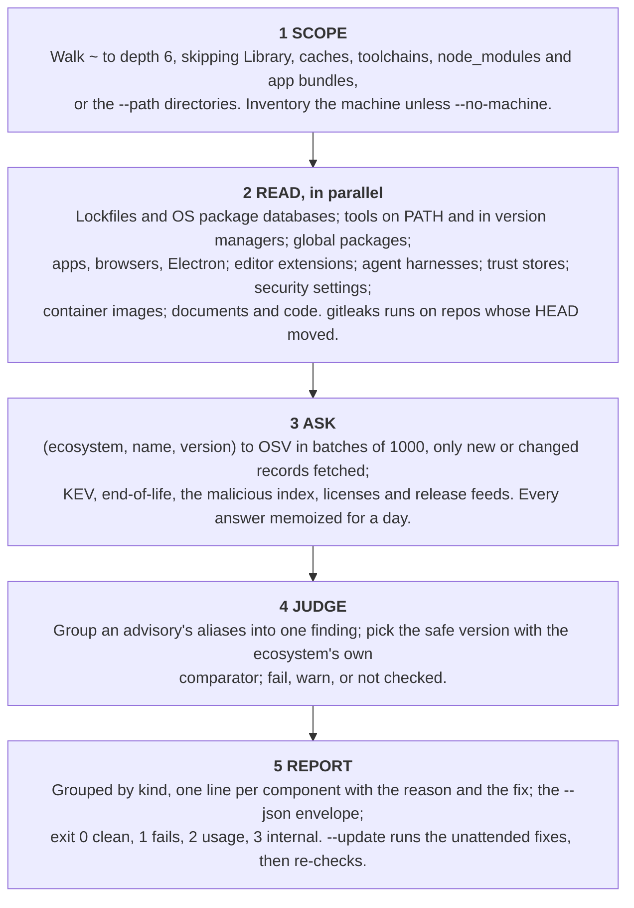

# How wpantry works

wpantry is one Rust binary that reads what is installed on this computer and what its git repos lock, asks a few public sources about exactly those versions, judges the answers against each ecosystem's own version rules, and says what applies. Answers live in one SQLite cache, so a second run the same day takes seconds, and a source it can't reach is reported "not checked", never clean.

[Full size](images/architecture.png) · [SVG source](images/architecture.svg)

## A run

## Where to read more

- [What it checks and where the answers come from](public/checks-and-sources.md), with the flow of a question from inventory to report.
- [Using it](public/usage.md), [installing and verifying a release](public/install.md), [the machine's settings it checks](public/posture.md), [the reports it writes](public/reports.md).
- [The CLI contract](../specs/cli-contract.md): the command line, exit codes, JSON and cache file, the only stable surface.
- [How it is put together, in detail](internal/architecture.md): the readers and their golden files, the comparators and their vectors, the cache, the binary and its dependencies, the tests, and what the Rust port left open and where it closed.
- [The source map](../rust/README.md).

The diagrams are drawn in the [Waffuru design language](https://waffuru.ai/brand): the source is the SVG in [`docs/images/`](images/), 1200 px wide, and the PNG beside it is the 2× render.
