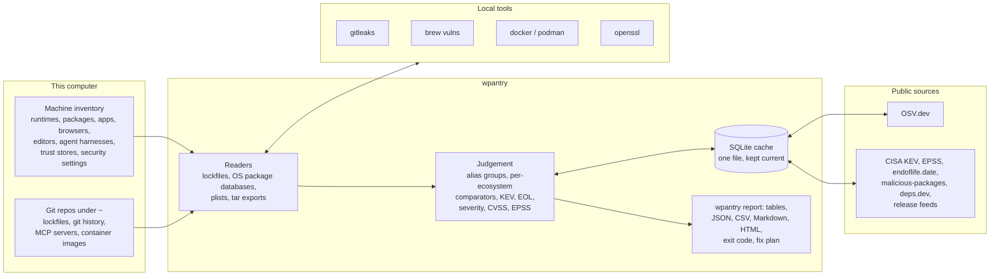

# How Pantry works

Pantry is one Rust binary. It reads what is installed on this computer and what its git repos lock, asks a few public sources about exactly those versions, judges the answers with each ecosystem's own version rules, and reports what applies.

- Answers live in one SQLite cache, kept current from OSV's change lists: a later run fetches only what changed.
- A source it can't reach is reported "not checked", never clean.

Pantry is three things in one simple pipeline:

1. **Sources**: verified CVEs, IOCs, YARA malware rules and other known attack vectors.
2. **`wpantry`**: a fast file scanner, run on a schedule or when triggered. Its cache keeps the sources and files it checked, the exposures it found, and how and when each was mitigated.
3. **Reports**: terminal tables, JSON, JSON Lines, CSV, HTML, Markdown.

It watches nothing live and needs no permission beyond reading files. You or an agent can trigger a scan or set a schedule. You can produce reports in various formats for however you need to consume them. JSON reports can go to an external reporting service that aggregates many machines.


[Full size](../images/architecture.png) · [SVG source](../images/architecture.svg)

## What happens during a Pantry file scan

```mermaid
%%{init: {"flowchart": {"wrappingWidth": 560, "nodeSpacing": 40, "rankSpacing": 36}}}%%
flowchart TB
  scope["<b>1 SCOPE</b><br/>Walk ~ to depth 6, skipping Library, caches, toolchains, node_modules and app bundles,<br/>or the --path directories. Inventory the machine unless --no-machine."]
  read["<b>2 READ, in parallel</b><br/>Lockfiles and OS package databases; tools on PATH and in version managers; global packages;<br/>apps, browsers, Electron; editor extensions; agent harnesses; trust stores; security settings;<br/>container images; documents and code. gitleaks runs on repos whose HEAD moved."]
  ask["<b>3 ASK</b><br/>(ecosystem, name, version) to OSV in batches of 1000, only new or changed records fetched;<br/>KEV, EPSS, end-of-life, the malicious index, licenses and release feeds.<br/>Answers kept current from OSV's change lists: only what changed since the last run is read."]
  judge["<b>4 JUDGE</b><br/>Group an advisory's aliases into one finding; pick the safe version with the ecosystem's own<br/>comparator; fail, warn, or not checked."]
  report["<b>5 REPORT</b><br/>Severity on CVSS&#39;s scale with CVSS and EPSS beside it; wpantry report renders the cache: areas of tables, JSON, CSV, Markdown, HTML;<br/>exit 0 clean, 1 fails, 2 usage, 3 internal. wpantry fix runs the unattended fixes, then re-checks."]
  scope --> read --> ask --> judge --> report
```



**Scope.** `repos::walk` finds the git repos (and, with `--path`, scans a directory without one as a single project). Build output and dependency directories are skipped everywhere a walk happens.

**Read.** A run is almost all waiting: on subprocesses (tool versions, npm, Python, openssl, gitleaks, Homebrew) and on HTTP. So:

- independent probes run at once (`utils::parallel::par_map`, results kept in order);
- the trust stores and Software Update run beside the inventory;
- gitleaks scans stale repos while the dependency checks wait on the network;
- the HTTP pool keeps a connection per parallel fetch;
- folders are read where a command would only list them (the Homebrew Cellar and Caskroom, `npm root -g`).

**Ask.**

- **Batch.** The OSV client posts `querybatch` with at most 1000 queries a request and follows `next_page_token` per query. A record is fetched (`GET /v1/vulns/{id}`, at most 8 in flight, `If-None-Match` with the stored ETag) only when its id is new or its `modified` time changed.
- **Change lists.** An answer is cached per (ecosystem, name, version) and kept current from OSV's change lists (`sources::osv_changes`). Per ecosystem there is a cursor (the newest change applied) and a chain start. A scan or `sync`:
  1. reads the list from the top down to the cursor, less a day's overlap for late exports, in 64 KiB ranges, skipping what it applied before;
  2. downloads the changed records that are held or name a package here (others are not kept);
  3. applies each to this machine's versions, matched locally with the ecosystem's order. A record only OSV can match (git ranges, an unknown order) sends those versions back to `querybatch`.
- **Freshness.** An answer given after its ecosystem's chain started stays current while the list keeps being read. More than 5,000 changes since the last read, or `--refresh`, starts a new chain and asks again. A list read in the last 15 minutes isn't reread. Without a list (git repos, your own advisory APIs) an answer is reused for a day. Failures are never cached.
- **Feeds** use the same memo: a key, a time to live, and an input fingerprint, so a cached result is reused offline or after a failure only for the same input (a changed repo HEAD, Homebrew listing or image gets a fresh answer).

**Judge.** Records are grouped by id, aliases and upstream CVE, so one vulnerability from two databases is one finding, named by its bare CVE when a record carries one. The fix a finding recommends is the version that repairs every record in the group, ordered by the ecosystem's own comparator. OSV decides whether a version is affected; Pantry only orders fixed versions to pick the safe one and to compare against "latest".

**Report.**

- **Fails:** a released fix, end of life, a malicious package, a committed secret from a provider-specific rule, a Critical or High posture setting.
- **Warns:** no fix yet (including a program exposed to an unfixed kernel advisory by what it does: a Go 1.24+ module listening with Multipath TCP on), an outdated app, an unpinned MCP server, an install script, a generic secret rule, a Medium or Low posture setting.
- **Not checked:** a source that couldn't be reached and had nothing cached, or a file that couldn't be read.
- **Severity:** every finding is rated on CVSS's scale (LOW, MEDIUM, HIGH, CRITICAL) by `checks::severity` after the checks run. An advisory takes its record's label, else its CVSS 3.x or 4.0 score (`utils::cvss`), or that of the records it aliases, or its CVE's (`sources::cve_scores`: OSV's record for the CVE, then CVE.org's; kept a week). Pantry's own checks take theirs from one table. The CVSS score and EPSS likelihood (`sources::epss`, the whole daily file, never a per-CVE request) sit beside it and never change it.
- **Rendering:** every report is rendered from the cache by `reporters` (`wpantry report`; `scan` and `fix` call it when they finish).

## The parts



## What it is, and is not

- A library crate, `wpantry`, and a thin binary, `wpantry-cli`. The library has no global state and never prints; the CLI owns stdout, stderr and exit codes.
- Not SAST, reachability analysis, guided remediation, an SBOM reader or an offline OSV mirror. gitleaks and `brew vulns` run as external tools, not ports. Windows is [#11](https://github.com/waffuruai/pantry/issues/11).

## Missing evidence is never clean

The rule every module follows: when Pantry cannot tell, it says so; a gap never makes the result look better.

- A missing tool fails (`MISSING`); an unreachable source warns (`unchecked`).
- An OSV answer more than a day stale (change list unread for a day, or a day old with no list) that couldn't be refreshed, and an advisory OSV names but can't serve, are reported unchecked; the findings they do give still stand.
- An advisory OSV changed but can't serve keeps its old record, which still counts, and is reported until the new revision arrives.
- A `querybatch` answer that isn't an object, or whose `vulns` isn't a list of advisories with ids, is an error, not "no advisories", and never replaces an earlier answer.
- A malicious-package report that can't be fetched is unchecked and asked again next run; nothing is made up.
- A lockfile that isn't the format it is named as (no `lockfileVersion`, no `module` line, a `packages` that isn't the section npm or pnpm writes), or that links outside its repo, is unchecked, not empty. `npm-shrinkwrap.json` wins over a `package-lock.json` beside it, as in npm.
- A trust store openssl can't load is unchecked, not "doesn't trust the distrusted CAs". `PIP_CERT`, when set, is pip's store and judged like any other.
- A posture check that can't tell says so, never passes.
- A gitleaks run that leaves no report, or one that isn't a list of findings, is a failed run (unchecked), never a repo with no secrets; only `[]` is none.
- A Python distribution whose metadata is missing, unreadable or names no version is an unchecked gap, never a package that isn't installed.
- An advisory whose only fixes are older than the installed version (it came back later) counts as unfixed, not as a downgrade fix.
- A container export cut short is an error, not an image with fewer files; an image whose packages can't be read (rpm-based) is unchecked.
- A program that leaves a background process holding its output pipes can't hold the scan past its timeout.
- Every parser is bounded: responses 128 MiB, JSON depth 128, lockfiles 64 MiB and 1 MiB a line, package databases 256 MiB, each file in an image export 64 MiB. Over a cap or malformed is unchecked.

## Readers

- Lockfiles are read line by line where the format allows; nothing is executed or resolved.
- Each format has golden files cut from real lockfiles, with the expected (ecosystem, name, version) list beside them, in [`rust/crates/wpantry/tests/lockfiles/`](../../rust/crates/wpantry/tests/lockfiles/README.md). Truncated and mangled copies of every golden file must never panic.
- Workspace members and local packages are not sent to OSV, so a local package sharing a name with a published one can't raise a false finding: package-lock entries outside `node_modules/`, Cargo packages without a crates.io source, uv's editable and virtual packages, path and `file:` dependencies, Composer `path` repositories, private Hex organizations, Conan `@user/channel` recipes.

| File | Ecosystem | Formats | Notes |
|---|---|---|---|
| `Cargo.lock` | `crates.io` | v1–v4 | Registry sources only |
| `package-lock.json`, `npm-shrinkwrap.json` | `npm` | v1–v3 | Name from the last `node_modules/` segment; links skipped |
| `pnpm-lock.yaml` | `npm` | v5, v6, v9 | Peer suffixes stripped; an entry's own `name:`/`version:` wins |
| `yarn.lock` | `npm` | v1, berry | Berry's `npm:` and `patch:` resolutions count |
| `bun.lock` | `npm` | JSONC | The binary `bun.lockb` isn't read |
| `deno.lock` | `npm` | v3–v5 | `npm:` entries; `jsr:` has no OSV ecosystem yet; another version is unchecked |
| `Package.resolved` | `SwiftURL` | v1–v3 | The repository URL without scheme or `.git`, as osv-scalibr names it |
| `go.mod` | `Go` | | `require` and `replace`; `toolchain goX`, else `go X`, is the `stdlib` package |
| `uv.lock`, `poetry.lock`, `Pipfile.lock` | `PyPI` | | Editable, virtual, git, directory, file and url sources skipped; names PEP 503-normalized |
| `requirements*.txt` | `PyPI` | | `==` pins only; `-r` includes followed inside the repo, each once |
| `Gemfile.lock` | `RubyGems` | | `GEM` `specs:`; a platform suffix is dropped |
| `composer.lock` | `Packagist` | | `packages` and `packages-dev`; `path` repositories and branches skipped |
| `pubspec.lock` | `Pub` | | `hosted` packages only |
| `mix.lock` | `Hex` | | `:hex` tuples from the public `hexpm` repository |
| `gradle.lockfile`, `pom.xml` | `Maven` | | `pom.xml`: literal versions and same-file properties only, no parent or remote resolution |
| `packages.lock.json` | `NuGet` | v1–v2 | `Project` references skipped |
| `conan.lock` | `ConanCenter` | v0.4–v0.5 | A `@user/channel` recipe is private and skipped |

OS packages are reported under their source package and version, the names OSV matches:

| Source | Read | Package reported |
|---|---|---|
| `/var/lib/dpkg/status` | Stanzas with `Status: install ok installed` | `Source:` (and its version when given), else `Package:` |
| `/lib/apk/db/installed` | `P:`, `V:`, `o:` records | `o:` origin, else `P:` |
| `rpm -qa --qf …` | openSUSE, SUSE | `NAME` |
| dnf advisories, the Arch security tracker | Their own feeds | |

The `os-release` `ID` (never a derivative's `VERSION_ID`, which would name the wrong release) picks the OSV ecosystem string, settled against osv-scalibr's `MakeEcosystem` tests: `Debian:<VERSION_ID>`, `Ubuntu:<VERSION_ID>`, `Alpine:v<major>.<minor>`, `Wolfi`, `Chainguard`, `openSUSE:Leap <VERSION_ID>`, `openSUSE:Tumbleweed`, `SUSE:<VERSION_ID>`. No `VERSION_ID` (Debian testing, say) and anything unmapped is unchecked: a wrong string would come back silently clean.

Container images:

1. `docker|podman create`, then `export` into a temp directory.
2. A tar reader written here keeps only the files the readers want, caps each at 64 MiB and ignores entries escaping the root.
3. The same lockfile and OS-database readers run on the result, without layer attribution. The kernel's source package (only headers in a container) is left out.
4. The container and directory are removed, even on error. Answers are memoized per image id for 30 days.

The machine inventory finds runtimes and tools on PATH and in every version manager (mise, asdf, pyenv, nvm, volta, uv, rustup, …), global packages (each Python's `site-packages` metadata read under `-I -S`, npm, cargo, pipx, gem), apps and browsers (plists, the Homebrew cask catalog), Electron bundles, pending OS updates, Docker, editor extensions, and the MCP servers, plugins and skills of the coding agents. The trust-store check reads the system, OpenSSL, Homebrew, certifi, pip and Node stores through `openssl`. The posture checks are read-only probes of the settings the CIS benchmarks name ([public/posture.md](posture.md)).

## Comparing versions

| Comparator | Used for | Tested against |
|---|---|---|
| semver 2.0 | crates.io, npm, SwiftURL, Pub, Hex, NuGet | semver.org §11 and `x/mod/semver`'s table |
| PEP 440 | PyPI | `packaging`'s version tests |
| Go | Go modules (`v` prefix, pseudo-versions, `+incompatible`) | `golang.org/x/mod/semver` |
| dpkg | Debian, Ubuntu | 656 pairs judged by `dpkg --compare-versions` |
| apk | Alpine, Wolfi, Chainguard | apk-tools' `version.data` (GPL-2.0, so fetched on demand, a selection inline) |
| rpmvercmp | openSUSE, SUSE | rpm's `rpmvercmp.at` |
| RubyGems | RubyGems | rubygems' `test_gem_version.rb` |
| Maven | Maven | maven-artifact's `ComparableVersionTest` |
| Composer | Packagist | composer/semver's parser, comparator and sort tests |
| generic | ConanCenter, upstream release tags, apps, everything else | Pantry's own vectors |

Each is total and never panics; a version its grammar rejects falls back to the generic order.

## The cache

One SQLite file per machine (`~/.cache/wpantry/wpantry.db`, `$XDG_CACHE_HOME`, or `WPANTRY_DB`), FTS5 on, with the tables the [contract](../../specs/cli-contract.md#cache-sqlite) fixes: OSV records for what is here (never a mirror), which versions were asked and when, the latest findings, side feeds, the malicious-package index, memoized runs with fingerprints, and `meta` for ETags and bookkeeping. `search` ranks the cached advisories with FTS5. A cache outlives releases: schema changes are additive, or bump `schema`.

## The binary

What goes into the binary is reviewed like the code ([internal/dependencies.md](../internal/dependencies.md)):

- Five direct dependencies: `serde`, `serde_json` without `derive`, `rusqlite` bundled, `ureq`, `rustls` with `ring`. Each pinned `=x.y.z`, enforced by `tests/pins.rs`.
- `Cargo.lock` committed; every build `--locked` on the exact toolchain `rust/rust-toolchain.toml` names; `cargo deny` and `cargo vet` gate every merge.
- Everything else is written here: lockfile parsers and TOML and YAML line subsets, comparators, argument parsing, a regex subset, SHA-256, FNV fingerprints, civil dates, tar and plist readers, and the `Net` trait with one `ureq` implementation and one recording fake for tests.
- `unsafe` is forbidden crate-wide.

A release ([internal/release.md](../internal/release.md)):

- is built from a tag with `lto`, `codegen-units = 1`, `strip`, `--remap-path-prefix` and `SOURCE_DATE_EPOCH` from the commit, twice from two paths, and fails on any difference;
- ships each target with `SHA256SUMS`, a GitHub build-provenance attestation and a sigstore bundle, plus a signed packslip for the release; `install.sh` and mise verify them before installing ([public/install.md](install.md));
- v0.2.0 sizes: 3.5 MiB aarch64 Linux (musl, static), 4.0 MiB x86-64 Linux, 6.5 MiB macOS universal.

Programs run as scanners or data sources: `gitleaks`, `git`, `openssl`, `brew`, `docker` or `podman`, and `rpm`; the inventory also runs inventoried tools' version and listing commands and the OS update tools. Every program is an argument vector through `utils::process::exec`, stdin closed, with a timeout; never a shell string.

The network client (`net::Http`) connects only to the hosts in `net::HOSTS`, the list [public/checks-and-sources.md](checks-and-sources.md#sources) shows. Any other URL is refused before connecting; a test checks every source's URL against the list. Server certificates are verified by the platform's trust store (the keychain on macOS, the system bundle on Linux) through `rustls-platform-verifier`, so a CA the machine distrusts (with `wpantry fix ca-trust` or by hand) is distrusted by Pantry's own requests too.

## Tests

- **Unit tests** live beside the code.
  - Readers: golden files ([`tests/lockfiles/`](../../rust/crates/wpantry/tests/lockfiles/README.md)).
  - Comparators: their upstream's vectors ([`tests/vectors/`](../../rust/crates/wpantry/tests/vectors/)).
  - `tests/scan.rs`: a scan end to end against the recording fake network.
  - `tests/image.rs`: real `alpine` and `debian` images (ignored by default; CI runs it on Linux).
  - `tests/pins.rs`, `tests/assets.rs`: the dependency and packaging rules.
- **Contract suite**: Rust integration tests in `rust/crates/wpantry-cli/tests/` (`mise run contract`). They start the binary with a temp `HOME` and `WPANTRY_DB`, offline, and check only stdout, stderr, exit codes and the cache file.
- **Other tests**: the HTML viewer (`rust/crates/wpantry/assets/report/test-viewer.cjs`) and `install.sh` (`rust/release/`).
- **Tasks**:

  ```bash
  mise run test       # Rust tests, the install.sh test, the scripts/ tests, the HTML viewer test
  mise run contract   # the contract suite
  mise run lint       # shell and workflow linters
  mise run coverage   # Rust tests and contract suite under cargo-llvm-cov; fails under 90% line coverage
  ```

  CI runs the same tasks on Linux and macOS, plus `cargo deny` and `cargo vet`.

## What the port left open, and where it closed

The Rust port's PRD and design are archived in [specs/archived/](../../specs/archived/01-rust-port.md). Checked against the code, releases and open pull requests on 2026-10-31:

- **TLS roots**: the binary trusted Mozilla's bundle, not the machine's store, so a CA distrusted locally was still trusted by Pantry's own requests. Closed: server certificates are verified by the platform's trust store (above).
- **Hosts**: the list of hosts the binary may contact was documentation only. Closed: `net::HOSTS` is enforced before any connection, with a test over every source's URL.
- **Feeds under hostile data**: the response, depth, line and file caps were in place; the per-feed hardening (fix versions substituted into commands, capped reads of repo files, plists and caches, control characters in reports) is [#39](https://github.com/waffuruai/pantry/pull/39).
- **Recorded online cases**: the contract suite ran offline only. [#71](https://github.com/waffuruai/pantry/pull/71) adds eleven OSV records and a KEV entry recorded on 2026-10-30, seeded into the cache, with lockfiles at the last affected and first fixed version of each.
- **ops**: built `wpantry` from a pinned commit until the first signed release. Closed: ops pins release 0.2.0 and installs it through mise's packslip backend with the release workflow's signing identity pinned.
- **Shared audits**: whether to import other organizations' `cargo vet` audits, which carry their auditors' published identities. Decided: imported (Mozilla, Google, the Bytecode Alliance), since those identities are public where the audits are; the rest is audited or exempted here ([internal/dependencies.md](../internal/dependencies.md)).
- The PRD's tracking issues were never filed; its criteria are met or closed above, so none are needed.

## Where to read more

- [What it checks and its sources](checks-and-sources.md), [usage](usage.md), [install](install.md), [machine settings](posture.md), [reports](reports.md).
- [The CLI contract](../../specs/cli-contract.md): command line, exit codes, JSON and cache file; the only stable surface.
- [The source map](../../rust/README.md).

Diagrams use the [Waffuru design language](https://waffuru.ai/brand): SVG source in [`docs/images/`](../images/), 1200 px wide, with a 2× PNG beside it.
