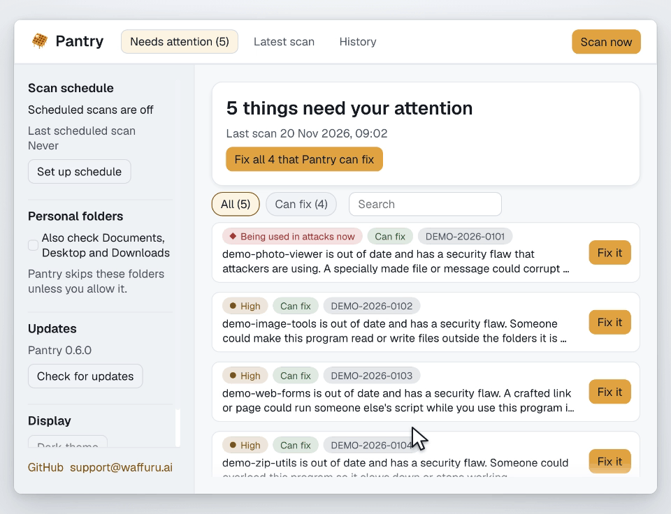
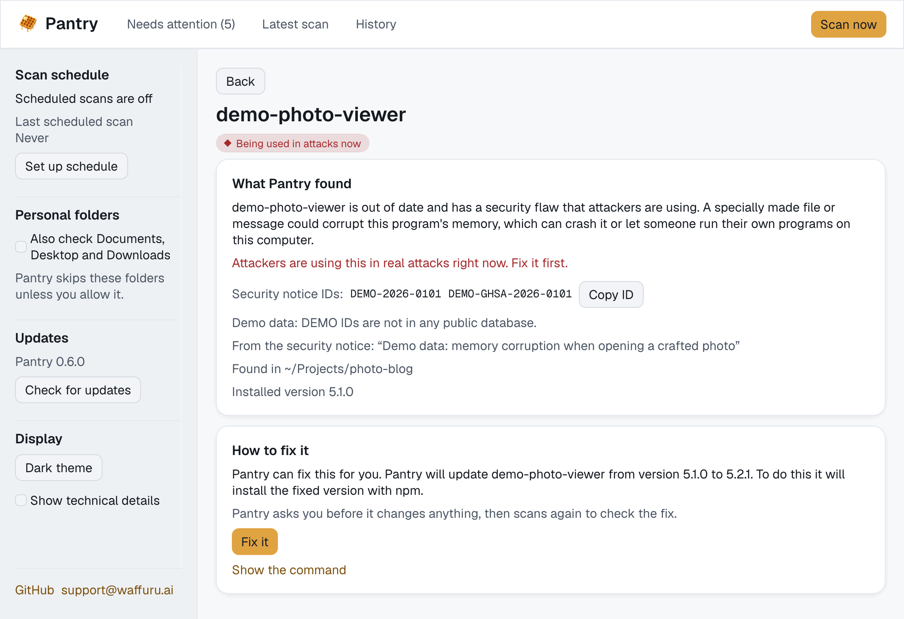
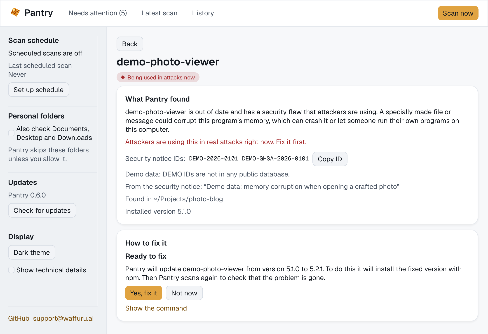
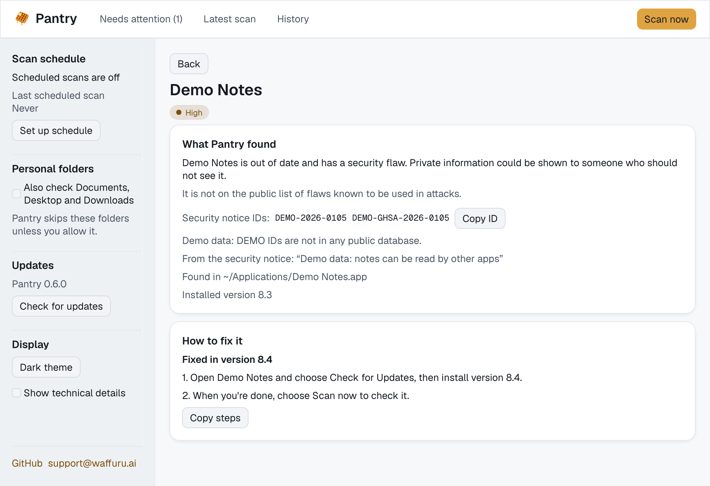

# Pantry Desktop

Pantry Desktop is the Pantry app with a window. It looks for known security problems on your computer, tells you about each one in a plain sentence, and fixes the ones it can after you say yes. It uses the same scanner as the `wpantry` command, so the app and the command line see the same results.

To install it, see [Download Pantry Setup](install.md#download-pantry-setup).

The pictures on this page use made-up demo data.

## The first time you open Pantry

Pantry explains what it looks at (the apps you installed, developer tools, your projects and the packages they use, and passwords or keys saved in project files) and what it won't do: it never changes anything without your OK, and your results stay on this computer. To look up security notices it sends the names and versions of what it finds to public advisory services. It sends no usage data.

Choose **Run first scan**. The first scan can take a few minutes, and you can keep using your computer while it runs. **Cancel** stops it.

## The home screen

The headline answers one question: does this computer need anything? It says how many things need your attention and when the last scan ran. If a check could not finish (for example, a website did not answer), the headline says the results may not be complete.

The headline counts only the latest scan. If an earlier scan found a problem that no scan has checked again since, it shows below the list under **From earlier scans**, with where that scan looked and, for a problem attackers are using, the same red label as a row. **Scan that folder again** (or **Scan this computer again** for a scan of the whole computer) checks it now. When Pantry cannot repeat that kind of scan, it says so. **Dismiss** hides it from the home page; the scan history keeps it, and **Latest scan** lists what you dismissed with **Show again**. If the folder is no longer there, Pantry says so and offers **Dismiss**.

Each row is one problem in one sentence, with how serious it is in words, a shape and a colour. A published security flaw starts the same way everywhere, such as "photo-tools has a security flaw with no fix yet." or "photo-tools is out of date and has a security flaw." When the security notice says what kind of flaw it is, the sentence says what it could let someone do, such as "A specially made file or message could corrupt this program's memory". Pantry's own checks (an app past its end of life, a tool a check needs that is not installed, a package that runs commands as it installs) say what the check found instead. A package published to cause harm is marked **Known harmful** and says to remove it. When two rows would read the same, each says where it is, such as "In ~/Projects/site". A long sentence wraps onto a second line; past two lines it is cut short, and holding the pointer over the row shows all of it. Problems attackers are known to be using come first, marked **Being used in attacks now**, then the most serious ones. Less urgent rows sit under **Show lower priority**. **Can fix** filters the list to the problems Pantry can fix for you, and **Search** finds a row by its name, sentence, notice ID (any of its IDs), weakness type such as CWE-79, or the notice's summary.

**Scan now** at the top right scans again at any time.

## What is this problem?

Choose a row to see what Pantry found, in this order:

- What could happen, in plain words, and whether attackers are using it right now. Pantry checks the US CISA list of flaws known to be used in attacks. When it could not read that list during the scan, it says it could not check, rather than that the flaw is not on it.
- The security notice IDs, such as a CVE number and GitHub's GHSA ID. Each one opens its notice on cve.org, GitHub or osv.dev, and **Copy ID** copies the first one so you can search for it. The screenshots use made-up DEMO IDs that are in no public database.
- The notice's own one-line summary, as published, under "From the security notice".

Pantry builds the plain sentence from the most serious weakness type the notice names (its CWE number), or from the words in its summary, such as "denial of service". Words that are denied ("no code execution", "does not crash") do not count. When the notice says neither, Pantry says only that the version has a publicly known flaw, and never guesses more.

**Show technical details** adds the affected versions, the fixed version, the CVSS severity score, the estimated chance attackers will try this in the next 30 days (EPSS, as "about 3 in 100"; left out when attackers are already using it), the weakness type, how the project depends on the package and the full path.

## Fix it

**Fix it** on a row opens that problem. Pantry shows what it found, where, the version you have, and exactly what it will change. Pantry says in words what the fix will do only when the command is exactly the usual one for that tool, such as `npm install photo-tools@2.0`. For any other command it says "Pantry will run one command." and shows the command itself. If the command has anything besides plain letters, digits, punctuation and single spaces (hidden or look-alike characters, unusual spaces, or more than 2,000 characters), it could read differently from how it runs, so Pantry does not offer it and says "Pantry could not verify the command for this fix." This includes a command with a non-English letter in a folder name. Nothing happens until you choose **Yes, fix it**. Then Pantry makes the change, scans the same place again and tells you **Fixed and checked** or **Still open**. If Pantry could not read the results again afterwards, it says **Could not confirm. Scan again.** **Not now** goes back without changing anything. If you cancel a fix, or it runs too long, Pantry says it may have partly run and offers **Scan now**.

## Fix all

When Pantry can fix more than one problem, the headline offers **Fix all N that Pantry can fix**. Pantry lists every change, asks you once, then fixes them one at a time with a result for each, and scans once at the end to check them. **Show the commands** shows exactly what each fix will run. A fix whose command Pantry could not verify is listed as **Can't run** and never runs. If a fix does not work, **Show details** next to it shows what the scanner said. If you cancel, the fix that was running is marked **Stopped** (it may have partly run), the rest are **Skipped**, and **Scan now** in the same card checks where things stand.

## Show me how

Some problems need you: an app from a vendor, something that needs an administrator password, or a change to a project's code. Those rows have **Show me how** instead of **Fix it**. You get numbered steps, including how to open a terminal when one is needed, and a **Copy steps** button. When the maker has not released a fix yet, Pantry says so and can check for one each time it scans. After you follow the steps, choose **Scan now** to check.

## Scheduled scans

In the sidebar, **Scan schedule** sets how often Pantry scans by itself: every hour, day, week, month, quarter or year, at a time you choose. A scheduled scan refreshes the security notices and scans. It never fixes anything. If Pantry is open when a scheduled scan finishes, the window shows the new results.

The schedule is one per account and is the same one `wpantry schedule` sets up. Pantry uses the system's own scheduler: launchd on macOS, a user timer or cron on Linux, and Task Scheduler on Windows (while you are signed in, with no window popping up). On macOS, if turning a schedule off did not finish and the system still has the scan registered, the sidebar says **A scheduled scan is still registered** and offers **Remove it** to try again.

## Personal folders

Pantry leaves your Documents, Desktop and Downloads folders out unless you allow them. The results then show "Skipped by your choice: personal folders". This is not an error and does not count as an unfinished check.

To include them, tick **Also check Documents, Desktop and Downloads** in the sidebar. On macOS, Pantry also needs Full Disk Access, which you give once:

1. Choose **Open Full Disk Access** in Pantry.
2. Turn on Pantry in the list. If it is not there, choose the + button and pick Pantry from the Applications folder in your home folder.
3. Come back to Pantry and choose **Scan now**.

Scheduled scans on macOS always leave these folders out, because nobody is there to answer a permission question.

## More details

**Show technical details** in the sidebar adds commands, the scores and versions behind each problem, folder paths in full, and scan numbers. **Latest scan** lists everything the last scan saw. **History** shows recent scans, fixes and problems that are confirmed fixed.

Keyboard: Esc goes back, Cmd+R (Ctrl+R on Windows and Linux) scans, Cmd+F (Ctrl+F) searches.

## Where Pantry keeps its data

Everything stays on this computer.

| What | macOS | Windows | Linux |
| --- | --- | --- | --- |
| The app | `~/Applications/Pantry/Pantry.app` | `%LOCALAPPDATA%\Programs\Pantry` | `~/.local/share/pantry-desktop` |
| App settings (theme, window size, last page) | `~/Library/Application Support/ai.waffuru.pantry.desktop` | `%LOCALAPPDATA%\Waffuru\Pantry` | `~/.local/state/pantry-desktop` |
| Scan results and history | `~/.cache/wpantry/wpantry.db` | `%LOCALAPPDATA%\wpantry\wpantry.db` | `~/.cache/wpantry/wpantry.db` |
| Scheduled scan results and log | `~/.local/state/wpantry` | `%USERPROFILE%\.local\state\wpantry` | `~/.local/state/wpantry` |

Removing Pantry with Pantry Setup keeps your scan history and settings. See [Uninstall Pantry Desktop](install.md#uninstall-pantry-desktop).

## Getting help

- Email support@waffuru.ai. The sidebar has the same link.
- Report a problem or ask a question on [GitHub](https://github.com/waffuruai/pantry/issues).
- When something goes wrong, Pantry shows the problem in plain words. **Show details** shows the scanner's own message, which is useful to include when you ask for help.
- If a scan could not reach the internet, **Scan with saved data** repeats that same scan using the security notices Pantry already has.
