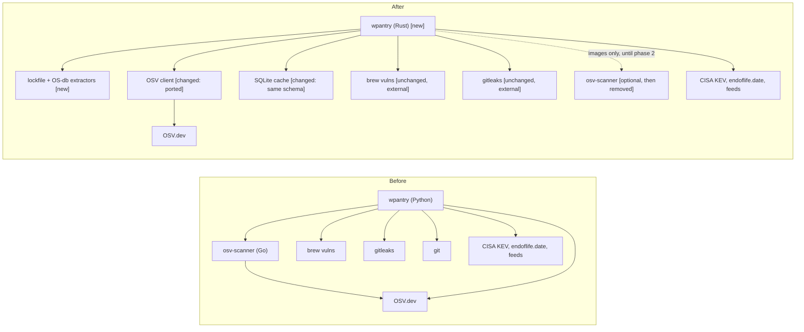

# wpantry ships as one verifiable Rust binary

## TL;DR

Port wpantry to Rust as a `0.x` crate plus a signed static binary, and replace osv-scanner for lockfiles and Linux package databases (we cannot link a Go binary). Dependencies are minimal and hard-pinned; the [CLI contract](cli-contract.md) is the only stable surface. Today the Python implementation in `python/` works and defines that contract; Python is removed once the Rust binary ships.

## Architecture

Removed: the Python runtime requirement (phase 3) and osv-scanner as a required tool (phase 1; optional for images until phase 2).

## Terms

| Term | Meaning here |
|---|---|
| OSV | The [OSV.dev](https://osv.dev) advisory database and its API; the main source |
| KEV | CISA's Known Exploited Vulnerabilities list; marks findings exploited in the wild |
| EOL | End of life, from [endoflife.date](https://endoflife.date); a runtime past it fails |
| Ecosystem string | OSV's name for where a package lives: `crates.io`, `npm`, `PyPI`, `Go`, `Debian:12`, `Alpine:v3.20`. A wrong one returns no advisories, not an error |
| Lockfile | A file pinning exact dependency versions (`Cargo.lock`, `pnpm-lock.yaml`, …) |
| querybatch | OSV's `POST /v1/querybatch`: up to 1000 (ecosystem, name, version) queries per request, answered with ids and `modified` times |
| Attestation | GitHub's signed build provenance for a release artifact, checked with `gh attestation verify` |

## What it is

A Rust workspace (`rust/crates/wpantry` library, `rust/crates/wpantry-cli` binary) that does everything the Python implementation (`python/`, since removed) did, behind the same CLI, JSON and cache. In our usage osv-scanner does no local version matching: it sends (ecosystem, name, version) to OSV `querybatch`, exactly like the former `python/wscanner/osv.py`. So the port is extractors plus the client we already have, not a vulnerability-matching engine. Detail lives in [design/rust-port.md](design/rust-port.md).

**Not:** SAST; reachability analysis; guided remediation; SBOM input; an offline OSV mirror; a gitleaks or `brew vulns` port; Windows (yet).

## Why

wpantry is the foundational security piece for ops, syrup, wsentinel and wos. A Rust crate lets them embed it instead of shelling out to Python plus a Go binary, and a reproducible, signed static binary is something anyone can verify before running it with access to their whole home directory.

## Why now

The Python tool works and has just been frozen into a contract (schema 1), so there is a reference to diff against. wsentinel is about to depend on it, and the cheapest time to change the runtime is before it has callers. Releasing it open source while the need is fresh gets it reviewed early.

## Acceptance criteria

### Functionality

- F1. Default scope is the whole computer: machine inventory plus every git repo under `$HOME`, found by the walk rules in [cli-contract.md](cli-contract.md#scope-walk); `--path DIR` (repeatable) limits the repo checks; `--no-machine` skips the inventory. Evidence: Python, `python/test_wscanner.py` (`Scope`, `Contract`); Rust, `rust/crates/wpantry/src/repos.rs` tests; both, the scope tests in `tests/contract/test_contract.py`. Issue: pending.
- F2. One contract-test suite runs the binary named by `WPANTRY=` and passes on both implementations: subcommands, flags, exit codes 0/1/2/3, the `check --json` envelope and `Finding` types, `version`, `tools`, `skill`, the cache schema. Evidence: `tests/contract/test_contract.py` (offline) passed with `WPANTRY=python/bin/wscanner` and with `WPANTRY=rust/target/release/wpantry` (17 tests each, 2026-10-28) until Python was removed; CI job `rust`, Linux and macOS, runs it against the binary. The online cases with recorded fixtures: not evidence yet. Issue: pending.
- F3. `check --json` diff between Python and Rust (findings sorted, `impl` and `version` dropped) is empty on the org repos and inside Debian, Alpine and openSUSE containers before osv-scanner leaves `tools`. Evidence, 2026-10-28: runs on a developer Mac (the org repos, apps, Homebrew, local images) and in Debian 13, Ubuntu 24.04, Alpine 3.22 and openSUSE Leap 15.6 containers plus older point releases with fixable advisories, arm64 and x86-64 (`rust/README.md`, "F3 parity"). Not empty: no advisory Python reported is missing, three Rust bugs the runs found are fixed (an alias group's fix, the host kernel in images, `non-standard` licenses), and what differs is listed in `rust/README.md` (advisory names, source versions, finer groups, coverage Python lacked). On this evidence Python is removed (log, 2026-10-28). Issue: pending.
- F4. Lockfile parsers, in this order: `Cargo.lock`, `package-lock.json` v1–v3, `pnpm-lock.yaml` v6/v9, `Package.resolved`, `go.mod`, `uv.lock`; then `requirements*.txt`, `yarn.lock` v1/berry, `bun.lock`, `deno.lock`, `poetry.lock`, `Pipfile.lock`, `Gemfile.lock`, `composer.lock`; later `pubspec.lock`, `mix.lock`, `gradle.lockfile`, `pom.xml`, `packages.lock.json`, `conan.lock`. Each has golden files cut from real lockfiles. Evidence: `rust/crates/wpantry/tests/lockfiles/` (table in its README), lockfiles generated by cargo, npm 10, pnpm 8 and 10, Go 1.24, uv 0.11 (also for `requirements*.txt`, with a `-r` include), Yarn 1.22 and 4.18, Bun 1.4, Deno 1.46, 2.0 and 2.5 (lock v3, v4, v5), Poetry 1.2 and 2.5, pipenv, Bundler 4.0, Composer 2.8, Dart 3.13, Gradle 8.14, .NET SDK 8.0 (lock v1 and v2) and Conan 1.66 and 2.32 (lock 0.4 and 0.5, over locally exported recipes), with the expected packages from each tool's own listing; written by hand: `Package.resolved` (no Swift toolchain), `mix.lock` (no Hex repository reachable) and `pom.xml` (Maven writes no lockfile; its expected list from `mvn dependency:list`). Every name the scan finds is read (`lockfiles::tests::every_scanned_name_is_supported`); truncated and mangled copies of every golden file never panic. Issue: pending.
- F5. `go.mod`'s `go` directive is reported as package `stdlib` in the `Go` ecosystem, as osv-scanner does. Evidence: `lockfiles/gomod.rs` tests and the `go` golden file (a `toolchain` directive wins over `go`, as in osv-scalibr's gomod extractor). Issue: pending.
- F6. OS package databases: `/var/lib/dpkg/status` with binary → source mapping and `Debian:N` / `Ubuntu:X.Y` ecosystems; `/lib/apk/db/installed` with the `o:` origin; rpm via `rpm -qa --qf` on openSUSE and SUSE. dnf distros keep today's dnf-advisory logic and Arch its tracker. Evidence: `osdb.rs` tests; on an Ubuntu 24.04 host the dpkg extractor's 486 source packages equal `dpkg-query -W -f '${source:Package} ${source:Version}'`; `distros.rs` ports dnf and Arch unchanged. apk and rpm have fixture tests only, no container run yet. Issue: pending.
- F7. An `os-release` → OSV ecosystem-string table, with conformance fixtures taken from osv-scanner's testdata; an unmapped distro is reported `unchecked`, never clean. Evidence: `osdb.rs` `scalibr_conformance` (the cases of osv-scalibr's `extractor/filesystem/os/ecosystem` tests that this reads) and `unmapped_is_unchecked_never_clean`. Issue: pending.
- F8. OSV client: `querybatch` paged at 1000 queries per request with `next_page_token` followed; per-vuln fetch at most 8 in parallel with ETag; a record is refetched only when `modified` changed; aliases grouped into one finding per vulnerability. Evidence: `osv.rs` tests against the recording fake network (1501 queries in two batches, a second page followed, only new or changed records fetched, the ETag stored, a same-day rerun makes no requests); `rust/crates/wpantry/tests/scan.rs` end to end. Issue: pending.
- F9. `fixed_versions` and `pick_safe` behave as in Python, using the Python test vectors. Evidence: the Python vectors in the `versions.rs`, `osv.rs` and `check.rs` tests. Issue: pending.
- F10. Version comparators for semver, PEP 440, Go, dpkg, apk and rpmvercmp, and RubyGems, Maven and Packagist for their lockfiles, each tested against its upstream's own vectors. Evidence: semver.org §11 and x/mod/semver's table (inline); packaging's `VERSIONS` (`tests/vectors/pep440.txt`); 656 pairs judged by `dpkg --compare-versions` (`tests/vectors/dpkg.txt`); every case of rpm's `rpmvercmp.at` (inline); all 733 cases of apk-tools' `test/version.data` (GPL-2.0, so not vendored: a selection inline, the file on demand with `WPANTRY_APK_VECTORS`); the comparison, validity and canonical-segment cases of rubygems' `test_gem_version.rb` (inline); every ordering and equality case of maven-artifact 3.9's `ComparableVersionTest` (inline); composer/semver's normalize cases (`VersionParserTest`), `ComparatorTest`'s compare cases and `SemverTest`'s sort cases (inline; two dev branches, which Composer leaves unordered, sort by name). Issue: pending.
- F11. Feeds, KEV, EOL, `brew vulns`, mise, gitleaks, the malicious-package index, harnesses and editors are ported 1:1: the same inputs give the same findings (F3). Evidence: ported module for module: the tool catalog (`catalog.rs`, generated from Python's and compared with it by `tests/catalog.rs`), the PATH and version-manager finder (`tools.rs`), Pythons with pip, npm globals, `cargo install`s, pipx and gems (`packages.rs`), apps, browsers, Electron, pending macOS updates and Docker (`apps.rs`), editors (`editors.rs`), harness MCP servers, plugins and skills (`harnesses.rs`), `brew vulns` (`scanners.rs`) and, where mise poured bottles without the `brew` command, the Cellar inventory that checks them against OSV directly (`cellar.rs`, ops B11), the breach check with consent (`breach.rs`), the CA trust check (`catrust.rs`), plus the earlier KEV, EOL, gitleaks, malicious-package index and install-script checks, each with unit tests. On an Ubuntu 24.04 host, offline, the Rust inventory finds the same 118 components as Python's; same-findings parity is F3's. Issue: pending.
- F12. Container images (phase 2): `docker|podman create` then `export` to a temp directory, scanned by the same extractors; no layer attribution; the container and temp directory are removed even on error. Evidence: `images.rs`: `create`/`export`/`rm` through docker or podman, the export read by a tar reader written here that keeps only the files the extractors read, caps each at 64 MiB and ignores entries escaping the root (unit tests with crafted tarballs); the OS database and lockfile extractors run on the result; answers memoized per image id for 30 days. `tests/image.rs` scans real `alpine:3.20` and `debian:12-slim` images; CI runs it on Linux (`cargo test -- --ignored`). Issue: pending.

### Performance

- P1. A warm run (cache fresh, same day) finishes in under 5 s on a developer Mac. Evidence, 2026-10-28: 4 to 5 s warm on a developer Mac over the org workspace with `--licenses` and local images while the machine was busy (Python, on a quieter machine: 28 s); 1 to 3 s in the Linux containers. It was 39 s before the probes ran at once (`rust/README.md`, "Speed"). Issue: https://github.com/waffuruai/pantry/issues/22.
- P2. A cold whole-computer run is no slower than Python on the same machine; the walk stays bounded by depth 6 and the prune list (Python baseline, 2026-10-25: the walk of one developer's home took 0.75 s). Evidence: 2026-10-28, a developer Mac over the org workspace, each run alone: 136 to 149 s cold against Python's 183 s. Issue: https://github.com/waffuruai/pantry/issues/22.
- P3. The static binary is under 15 MB per target. Evidence: 3.8 MiB for `x86_64-unknown-linux-musl` (static-pie) built by `rust/release/build.sh`, 3.3 MiB for `x86_64-unknown-linux-gnu`; aarch64 and the macOS universal binary are measured by the release workflow's first run. Issue: pending.
- P4. Zero idle CPU: one-shot process, no daemon, no threads left after a command returns. Evidence: no daemon or background service; every thread ends with the work it was started for (`std::thread::scope` in the OSV and deps.dev fetches, the progress ticker joined in `Progress::finish`); `system::exec`'s pipe readers end when the pipes close, and a reader still blocked at the call's deadline, by a background process the program left holding its output, ends with that process instead of holding the scan (`exec_deadline_covers_processes_left_holding_the_pipes`). Issue: pending.
- P5. Peak RSS under 100 MB while parsing a 100,000-line lockfile (line-streaming parsers). Evidence: a generated `package-lock.json` of 112,511 lines (12,500 packages) peaks at 28.6 MiB RSS and parses in 0.31 s with the musl binary (`check --path … --no-machine --offline --json`). Issue: pending.

### Security

- S1. Supply chain of the binary: every dependency pinned `=x.y.z`, `Cargo.lock` committed, `rust-toolchain.toml` exact, every build `cargo build --locked`. Evidence: `rust/Cargo.toml`, `rust/Cargo.lock`, `rust/rust-toolchain.toml` (1.97.0); `rust/crates/wpantry/tests/pins.rs` fails on an unpinned or unlisted dependency; CI builds and tests `--locked`. Issue: pending.
- S2. CI runs `cargo deny` (advisories, crates.io-only sources, license allowlist) and `cargo vet`; either failing blocks the merge. Evidence: `rust/deny.toml`, `rust/supply-chain/`; CI job `rust-supply-chain` (cargo-deny 0.20.2, cargo-vet 0.10.2), which branch protection must list as required. Issue: pending.
- S3. Release profile `lto`, `codegen-units = 1`, `strip`, `--remap-path-prefix`, `SOURCE_DATE_EPOCH`; two builds of one tag are byte-identical. Targets `x86_64` and `aarch64-unknown-linux-musl`, macOS universal. Evidence: partial; `rust/release/build.sh` (`lto`, `codegen-units = 1`, `strip`, `--remap-path-prefix`, `SOURCE_DATE_EPOCH` from the commit) built `x86_64-unknown-linux-musl` byte-identical from two checkouts at different paths; `.github/workflows/release.yml` builds every target twice from two paths and fails on any difference. The first tag is the evidence for aarch64 and macOS. Issue: pending.
- S4. Tampered artifact → each release ships `SHA256SUMS`, a GitHub artifact attestation (`gh attestation verify`) and a cosign keyless bundle. Evidence: partial; `.github/workflows/release.yml` publishes `SHA256SUMS`, a GitHub build-provenance attestation and a cosign keyless bundle per artifact and verifies all three before creating the release (`docs/internal/release.md`, `docs/public/install.md`). Not run yet: the first tag is the evidence. Issue: pending.
- S5. What leaves the machine: (ecosystem, name, version) of what is installed or locked, to OSV, and feed requests, only to the hosts in [design/rust-port.md](design/rust-port.md#network); the developer's email only after opt-in consent. No file contents, paths or secrets are sent. Evidence: not evidence yet. Issue: pending.
- S6. Programs run: as scanners or data sources only `brew`, `gitleaks`, `git`, `openssl`, `rpm`, `docker|podman`; the machine inventory also runs the inventoried tools' own version and listing commands and the OS update tools, as Python does. Always an argument vector, never a shell string. Evidence: `external.rs` names the scanners and data sources (`gitleaks`, `git`, `openssl` for the CA trust check, `brew`, `docker` or `podman`, `rpm`); every program is run through `system::exec`, an argument vector with stdin closed and a timeout, never a shell. Issue: pending.
- S7. Hostile feed data → bounded parsers: size caps per response, depth caps on JSON, line-length caps on lockfiles and feeds; anything over a cap or malformed is `unchecked`. Evidence: partial; Rust caps responses at 128 MiB (`net::MAX_BODY`), JSON depth at serde_json's 128, lockfiles at 64 MiB and 1 MiB a line, package databases at 256 MiB (tests in `json.rs` and `tests/lockfiles.rs`); feeds still to audit. Issue: pending.
- S8. A missing tool or unreachable source is reported (`MISSING` fails, `unchecked` warns), never "clean". Evidence: Python, `python/test_wscanner.py` (`test_unreachable_feed_raises_instead_of_reporting_clean`, `test_lookup_offline_uses_cached_answers`); Rust, the same two tests in `feeds.rs` and `osv.rs`, `check.rs` `unchecked_is_reported_once`, and the contract's `test_exit_0_when_only_warnings_and_unchecked`; areas not yet ported are reported unchecked. Rust also reports stale or partial evidence as unchecked (review findings R01–R09, R13 on the port's PR): `osv.rs` `a_stale_answer_after_a_failed_refresh_is_a_gap`, `an_advisory_osv_cannot_serve_is_a_gap_and_is_asked_again`, `a_malformed_batch_answer_is_not_clean`; `malicious.rs` `an_unread_report_is_unknown_never_assumed_and_never_cached`; `db.rs` memo fingerprints; `lockfiles/mod.rs` `a_file_that_isnt_its_lockfile_is_an_error_not_empty`; `catrust.rs` `an_unusable_store_is_unchecked_not_clean`; `images.rs` `a_cut_short_export_is_an_error_not_an_empty_image`. Issue: pending.

## Phases

| Phase | Scope | Done when | Issue |
|---|---|---|---|
| 0 | Workspace skeleton (`rust/crates/wpantry`, `rust/crates/wpantry-cli`), contract tests (F2), CI gates (S1, S2) | Contract suite runs in CI against Python; the skeleton passes `version`, `tools`, `skill`; gates green | pending |
| 1 | Lockfile (first two groups of F4) and OS-database parity (F5–F10) | F3 diff empty on the org repos and the three containers; osv-scanner dropped from the Rust `tools` list | pending |
| 2 | Machine-inventory parity (F11), deps.dev licenses, remaining lockfiles, images (F12) | Full `check --json` parity on a developer Mac and a Linux host; osv-scanner gone entirely | pending |
| 3 | Signed releases (S3, S4); ops switches to the artifact; Python removed | `gh attestation verify` passes on a release; ops pins it by SHA-256; `python/` deleted | pending |

## Blockers and decisions

Status, 2026-10-27 (branch `rust`): phase 0 is done. The code for phases 1 and 2 is written: every lockfile of F4, the OS databases, the OSV client and comparators, the machine inventory (F11), licenses and images (F12). Both phases wait on the F3 parity runs, since api.osv.dev was unreachable from the sandbox the port was written in. Phase 3's release workflow is written (S3, S4) and waits on the first tag; the ops switch and removing `python/` follow parity and are the owner's call. See `rust/README.md`.

Status, 2026-10-28: the parity runs are done (F3 evidence) and `python/` is removed; its CA trust scripts, plain shell, moved to `ca-trust/`. ops builds wpantry from a pinned commit until the first release, then pins the release. P1 and P2 are met on a developer Mac.

- OSV rate limits, and possibly API keys later: one `querybatch` per 1000 queries with backoff; a key would arrive as an additive env var.
- Air-gapped use is unsupported: CI and first runs need egress to `api.osv.dev`; `--offline` is cache only, and `sync` (run by `schedule`) keeps that cache fresh for what has been scanned before.
- Distro ecosystem-string correctness: a wrong string is a silent "clean", so the F7 fixtures and the F3 container diffs gate removing osv-scanner.
- `brew vulns` output drift: an unexpected shape is reported `unchecked`.
- gitleaks stays an external tool.
- Images lose layer attribution (osv-scanner names the layer; `export` flattens).
- deps.dev license coverage is npm, PyPI, crates.io, Go, Maven, NuGet and RubyGems only; the rest count as unknown licenses.
- The rustls transitive tree is the largest part of the dependency surface; it is reviewed with `cargo vet` and `cargo deny` at every bump.
- Owner decides: TLS roots from `webpki-roots` (pinned, bundled) or the platform verifier (follows the OS trust store, including a `fix-ca-trust.sh` distrust). Until then the build uses `webpki-roots`, which ureq's `rustls` feature bundles.
- Owner decides: artifact verification on hosts without `gh` auth, either `SHA256SUMS` plus a warning, or require cosign.
- Proposed by the port, for review: the `os-release` table follows osv-scalibr's `MakeEcosystem` tests where they speak (`Ubuntu:<VERSION_ID>` without `:LTS`, `SUSE:<VERSION_ID>`), maps by `ID` only (a derivative's `VERSION_ID` would name the wrong release), and reports Debian, Ubuntu and Alpine without a `VERSION_ID` unchecked.
- Proposed by the port, for review: workspace members (package-lock entries outside `node_modules/`, Cargo packages without a crates.io source) are not queried, where osv-scanner queries some of them; a local package sharing a published name can then raise no false finding.
- The one-time JSON envelope change (bare findings array → schema 1 envelope) lands with this repo's first release; ops and any other `--json` caller switch at the same time.

| Date | Decision | Why | Who |
|---|---|---|---|
| 2026-10-25 | HTTP and TLS through `ureq` + `rustls`, pinned `=x.y.z` like everything else | The standard library has no HTTP client; rustls keeps the musl build static with no OpenSSL. "rustls is fine, we just want to pin versions" | Eric |
| 2026-10-25 | `rusqlite` with `bundled` and FTS5 | One vendored C file; keeps `search` and a cache file shared with Python | Eric |
| 2026-10-25 | `serde` + `serde_json` without `derive` | JSON is most of the data; no proc-macro tree | Eric |
| 2026-10-25 | Hand-rolled TOML/YAML line subsets (golden files from real lockfiles), per-ecosystem comparators, argument parsing, SHA-256 verification, FNV fingerprints and civil dates | Each is small; a crate each would multiply the audit surface | Eric |
| 2026-10-25 | Dependency allowlist: `serde`, `serde_json`, `rusqlite`, `ureq`, `rustls` and their locked transitives; nothing else | Minimal, reviewable surface | Eric |
| 2026-10-25 | Tag `v0.1.0` after the first `dev` → `main` merge | The Python `__version__` is already 0.1.0 | Eric |
| 2026-10-27 | The product is **Pantry** and the repository `waffuruai/pantry`; the command, crates (`wpantry`, `wpantry-cli`), release assets, cache and env vars are `wpantry` everywhere (crates.io, mise, Homebrew) | `pantry` is taken on crates.io; Waffuru crates take the `w` prefix; one name across install channels avoids confusion. The Python reference keeps `wscanner` until phase 3 removes it | Eric |
| 2026-10-27 | License: MIT (was Apache-2.0) | Owner's call, before anything is published | Eric |
| 2026-10-28 | Remove the Python implementation once the Rust one is verified on a developer Mac and the supported Linux distributions; only the Rust binary is released | "If we can verify the rust version works first as expected on this machine and linux vms we support then we can delete the python version"; type safety and few dependencies | Eric |
