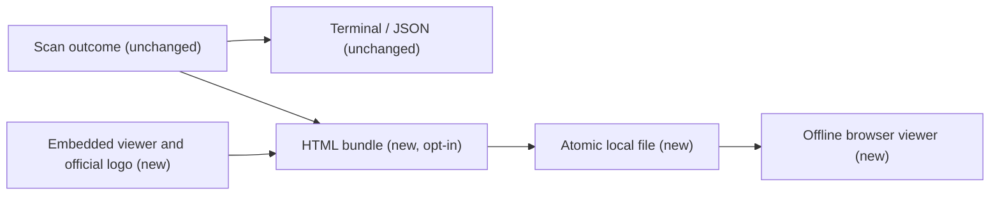

# Optional standalone HTML reports

## TL;DR

`wpantry scan --html report.html` saves the scan as an offline browser report in Waffuru's design language: the visual summary of a run, answering in order what was scanned, what is at risk, what can be patched and what to do by hand, with the cache's exposure and remediation logs when it has any. Normal terminal output remains the default; implementation and tests are proposed in #36.

## Architecture

## Terms

A **sidecar** is the optional HTML file alongside the existing output. **Incomplete** means a source could not be checked, not that the scan found no vulnerabilities. **Update plan** means commands supplied by findings, not proof that updates were applied.

## What it is

A single-file viewer for the same schema-1 result produced by the CLI, laid out as four numbered questions: **1 Scanned** (`checked` counts by area, every `unchecked` source as a gap, scope and policy), **2 At risk** (one row per component, grouped by area, areas and rows in `SKILL.md`'s fix order, KEV and severity badges, advisory links), **3 Patching** (the unattended steps of the plan, the fixes and resolved exposures the history records, the advisories with `fixed` empty and their mitigation) and **4 By hand** (the plan's manual steps, numbered, with the exact command or setting), then **5 History** (the exposure and remediation logs). The plan in the bundle is `report::steps`, the same one `wpantry fix --dryrun` prints; the history is `history::{exposures, fixes, scans}` for the last 90 days. The page follows `.agents/DESIGN.md`: the palette in dark and light, Instrument Serif, Geist and Geist Mono embedded as `data:` fonts, printable, readable at phone width, no request made when opened. It can also load saved JSON/CSV locally; an import has no recorded scope, plan or history, and CSV is explicitly partial.

**Not:** a new scanner, a hosted dashboard, an update executor, a replacement JSON schema, or a conversion service.

## Why

Community users need a readable report they can inspect and share without a terminal or a separate Python converter.

## Why now

The supplied report example establishes the desired interaction design while Pantry is shipping as a Rust binary.

## Acceptance criteria

All criteria track [#36](https://github.com/waffuruai/pantry/issues/36).

### Functionality

- F1: No flag creates no HTML; `--html FILE` writes the same outcome as JSON without changing stdout or scan exit codes. Evidence: `tests/contract/test_contract.py`, HTML cases.
- F2: Updates export the final recheck and dry runs the initial scan; failed updates remain indicated. Evidence: CLI contract tests and viewer behavior tests.
- F3: The four sections render from one scan: every finding kind under its own area, areas and rows in fix order, gaps under Scanned and never under an area, every non-unattended `fix_cmd` as a numbered step under By hand, the unattended ones under Patching; search, fail/warn/KEV filters, row details with advisory links, theme selection and printing work locally; a list of more than ten rows is paged (10 a page, 25, 50 or 100 on request, remembered) and an area or history log folds to its header, while print lists everything; the screen and print documents are well formed. Evidence: `tests/html/test-viewer.cjs` renders a fixture scan of every kind and checks each; `src/reporters/html.rs` checks the template and the bundle's plan. Visual verification: a report of a real scan of a Mac, opened in a browser (screenshots in the PR).
- F4: Unchecked sources, unfixed advisories and unknown licenses stay visible, even with zero finding rows; CSV never establishes complete coverage. Inventory counts are not a completeness score; imported JSON/CSV cannot establish missing scope options, and finding locations are never used to guess scope. Evidence: viewer behavior tests.
- F5: Invalid paths fail with code 3 before scanning; failures preserve the previous report and remove the staged file. Evidence: `src/reporters/html.rs` unit tests and CLI contract tests.
- F6: Update plan offers a preview and copyable prompt for an AI agent of the user's choice. The prompt includes all findings in the selected scan regardless of filters, preserves coverage gaps and unknown imported scope, and asks for scoped changes, tests and a fresh scan. CSV omissions remain unknown. Evidence: viewer tests exercise copied prompt contents, filtered/empty/imported reports and escaped preview text.
- F7: Print produces a light document of the same page for the selected scan with every row open: official branding, verdict, what was scanned, every finding with its explanation, the plan and the history. Screen filters and collapsed rows do not remove evidence from print; controls and the agent prompt are omitted. Paths and commands wrap and headings avoid orphaned page breaks. Both the print button and browser print events prepare the document without changing screen state. Evidence: viewer tests verify contents, well-formedness, escaping, partial/empty states and print events.

- F8: Current finding fields (`dep_scope`, `dep_direct`, `affected_range`) survive rendering, printing and copying the agent prompt; missing fields in older schema-1 reports remain unknown. Repo hooks, posture, hidden text, suspicious code and document rules stay visible without invented advisory URLs. Evidence: viewer regression tests and CLI JSON/HTML equality.
- F9: Generated reports identify their host, user, local history scan, effective posture scope, configured posture exclusions, suspicious-code warning exemptions and policy file choices, carry wpantry's own update plan (`plan`: one step per command with its mode and the findings it covers) and the cache's history (`history`: exposures, fixes and scans of the last 90 days, or null when the cache can't be read); a plan that does not fit the findings is ignored. Imported scan JSON has unknown scope/history; history JSON and JSONL exports are rejected rather than mistaken for current scans. The update flow keeps upstream remediation recording and verification before exporting the final recheck. Evidence: CLI contract tests and viewer coverage/print/prompt tests.

- F10: A generated online scan with explicit scope, positive inventory, no findings, no unfixed advisories and no unknown licenses shows a quiet Waffuru-branded “All clear. Nicely done.” state, including in print. Empty imports, zero inventory, offline scans, unknown scope and failed updates do not celebrate. The copy limits the result to the checked scope and never claims every vulnerability was checked. Evidence: paired viewer tests for the positive state and each incomplete/failed case.

### Performance

- P1: Zero additional scan/network requests and zero runtime converter dependencies when HTML is requested. Evidence: `finish` consumes the existing outcome and compile-time template, using std plus the existing JSON helper.
- P2: Exactly one output file with no external asset requests needed to open it. Evidence: embedded logo, CSS and script in `assets/report.html`; a browser network trace is not evidence yet.

### Security

- S1: Hostile report strings cannot close the JSON script element or become HTML markup. Evidence: `hostile_text_stays_json_data` and viewer escaping tests; links use fixed advisory-site URL prefixes.
- S2: Reports contain local paths and commands; privacy mitigation is explicit opt-in, Unix mode 0600, local-only imports, and no automatic upload or browser opening. Evidence: output permission test and source inspection.
- S3: The viewer cannot execute updates; copy controls preserve the exact proposed command, and a fresh scan is needed to verify changes. Evidence: viewer behavior tests and command-copy handler.
- S4: An existing destination symlink is replaced, not followed; incomplete generation never truncates an older report. Evidence: atomic sibling-file write and regression tests.
- S5: The agent prompt treats report fields and suggested commands as untrusted data to verify. It sends nothing automatically; the user can preview local details before sharing. Evidence: prompt copy handler and escaping/contents tests.

## Phases

| Phase | Scope | Done when | Issue |
|---|---|---|---|
| 1 | CLI, embedded viewer, docs and tests | Required checks pass and review is complete | #36 |

## Blockers and decisions

Visual QA: a report of a real machine scan was opened in a browser at desktop and phone width, dark and light, and its print preview checked (screenshots in the theming PR). Clipboard behaviour is checked by the viewer tests, not in a browser.

| Date | Decision | Why | Who |
|---|---|---|---|
| 2026-10-29 | Require an explicit output file; keep terminal output | Optional output requested by Tom | Tom |
| 2026-10-29 | Embed the official Waffuru PNG and use local system-font fallbacks | Works offline without additional dependencies or remote fonts | Tom's implementation |
| 2026-10-29 | Keep schema 1 intact inside a presentation bundle | Existing consumers remain compatible | Tom's implementation |
| 2026-10-30 | Add a report-specific prompt for any AI agent to Update plan | Requested by Tom; preserves complete scan context and asks for verification | Tom |
| 2026-10-30 | Print a dedicated full selected report instead of the active screen tab | Tom reported poor print presentation; printed evidence should not depend on filters or expanded rows | Tom |

| 2026-10-29 | Treat the supplied ZIP as a mockup, refining around actual scanner outputs | Explicit user clarification; coverage and grouped actions take precedence over the mockup layout | Tom |

| 2026-10-31 | Integrate current dev finding metadata, policy context and history-aware rechecks | Tom requested compatibility with Eric’s merged changes; keep HTML scoped to current scans | Tom |

| 2026-10-31 | Add a restrained branded completion state for clear, scoped scans | Tom requested a happy finish without excessive celebration; incomplete evidence keeps cautious wording | Tom |
| 2026-11-01 | Lay the page out as the four questions a run answers (scanned, at risk, patching, by hand) plus history, in the design language, with wpantry's own plan and the cache history in the bundle | Eric wants the report to be the visual summary of a run; the plan and the fix order live in the scanner, not twice | Eric |
