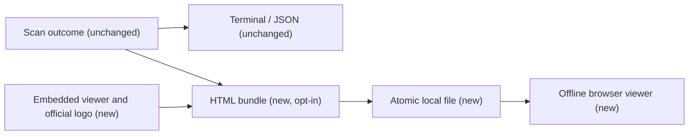

# Optional standalone HTML reports

## TL;DR

`wpantry check --html report.html` saves the scan as a searchable, offline browser report using the official Waffuru mark and palette. Normal terminal output remains the default; implementation and tests are proposed in #36.

## Architecture

## Terms

A **sidecar** is the optional HTML file alongside the existing output. **Incomplete** means a source could not be checked, not that the scan found no vulnerabilities. **Update plan** means commands supplied by findings, not proof that updates were applied.

## What it is

A single-file viewer for the same schema-1 result produced by the CLI, with scan scope, coverage, findings, advisory links and proposed commands. It can also load saved JSON/CSV locally; CSV is explicitly partial.

**Not:** a new scanner, a hosted dashboard, an update executor, a replacement JSON schema, or a conversion service.

## Why

Community users need a readable report they can inspect and share without a terminal or a separate Python converter.

## Why now

The supplied report example establishes the desired interaction design while Pantry is shipping as a Rust binary.

## Acceptance criteria

All criteria track [#36](https://github.com/waffuruai/pantry/issues/36).

### Functionality

- F1: No flag creates no HTML; `--html FILE` writes the same outcome as JSON without changing stdout or scan exit codes. Evidence: `tests/contract/test_contract.py`, HTML cases.
- F2: Updates export the final recheck and dry runs the initial scan; failed updates remain indicated. Evidence: CLI contract tests and viewer behavior tests.
- F3: Search, status/category/KEV filters, finding details, advisory links, exact-command deduplication, theme selection and printing work locally. Evidence: `tests/html/test-viewer.cjs` exercises viewer logic; visual browser verification is not evidence yet.
- F4: Unchecked sources, unfixed advisories and unknown licenses stay visible, even with zero finding rows; CSV never establishes complete coverage. Evidence: viewer behavior tests.
- F5: Invalid paths fail with code 3 before scanning; failures preserve the previous report and remove the staged file. Evidence: `src/html.rs` unit tests and CLI contract tests.

### Performance

- P1: Zero additional scan/network requests and zero runtime converter dependencies when HTML is requested. Evidence: `finish` consumes the existing outcome and compile-time template, using std plus the existing JSON helper.
- P2: Exactly one output file with no external asset requests needed to open it. Evidence: embedded logo, CSS and script in `assets/report.html`; a browser network trace is not evidence yet.

### Security

- S1: Hostile report strings cannot close the JSON script element or become HTML markup. Evidence: `hostile_text_stays_json_data` and viewer escaping tests; links use fixed advisory-site URL prefixes.
- S2: Reports contain local paths and commands; privacy mitigation is explicit opt-in, Unix mode 0600, local-only imports, and no automatic upload or browser opening. Evidence: output permission test and source inspection.
- S3: The viewer cannot execute updates; copy controls preserve the exact proposed command, and a fresh scan is needed to verify changes. Evidence: viewer behavior tests and command-copy handler.
- S4: An existing destination symlink is replaced, not followed; incomplete generation never truncates an older report. Evidence: atomic sibling-file write and regression tests.

## Phases

| Phase | Scope | Done when | Issue |
|---|---|---|---|
| 1 | CLI, embedded viewer, docs and tests | Required checks pass and review is complete | #36 |

## Blockers and decisions

Visual browser QA is pending: the available browser tool rejected `file:` navigation and prohibited an alternate route to that same action. Reviewers should open a generated HTML report in their browser and inspect desktop/mobile layout, print preview and clipboard behavior before merge.

| Date | Decision | Why | Who |
|---|---|---|---|
| 2026-10-29 | Require an explicit output file; keep terminal output | Optional output requested by Tom | Tom |
| 2026-10-29 | Embed the official Waffuru PNG and use local system-font fallbacks | Works offline without additional dependencies or remote fonts | Tom's implementation |
| 2026-10-29 | Keep schema 1 intact inside a presentation bundle | Existing consumers remain compatible | Tom's implementation |
