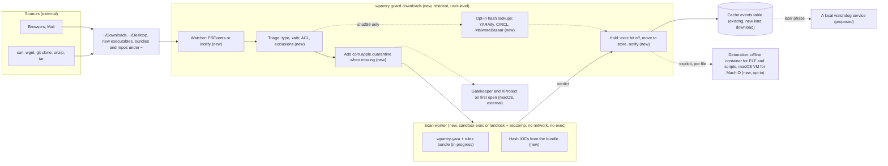

# Downloads are checked for malware before they run, without getting in the way

## TL;DR

`wpantry guard downloads` is a resident guard that notices files arriving from browsers, mail, `curl`, `wget`, `git clone` and archive tools, makes sure macOS's Gatekeeper will check them when they're opened, scans them statically in a sandboxed worker with pantry's YARA engine and hash IOCs, and holds anything that is malware: execute bit off, quarantine xattr on, moved into a quarantine store, one notification. Nothing leaves the machine unless the person turns on hash lookups. Status 2026-11-04: design only; the YARA engine (`rust/crates/wpantry-yara`) is in progress and nothing of the guard is built. Detail lives in [design/download-guard.md](design/download-guard.md).

## Architecture

Before: the scheduled scan reads installed software and repos once a day, and nothing is resident (the clipboard guard was removed on 2026-11-05: live watching belongs to a resident watchdog, see Open questions). After (new parts marked):

How wpantry works today: [docs/public/architecture.md](../docs/public/architecture.md).

## Terms

| Term | Meaning here |
|---|---|
| Quarantine xattr | macOS's `com.apple.quarantine` extended attribute. Gatekeeper and XProtect check a file that carries it when it is first opened |
| Quarantine store | pantry's directory of held files. Not the xattr |
| Hold | Execute bit off, quarantine xattr kept or added, file moved into the quarantine store, one notification |
| Landed | A new file whose writes have settled and which no longer has a partial-download name |
| Malware | A verdict from a hash IOC, a high-confidence rule or a lookup that names a family. Always Critical, always held |
| Risky | Active content that runs on open (macros, PDF JavaScript, `.terminal` commands). Notified, not held |
| Detonation | Running a held sample in an offline, disposable environment to see what it does. Never on the host |

## What it is

A user-level resident process, installed at login with `wpantry schedule install --download-guard` and off by default, that watches the paths where downloads and clones land, scans each landed file with pantry's own engine in a sandboxed worker, and holds malware. It also adds the quarantine xattr that `curl`, `wget`, `git` and command-line archive tools never set, so Gatekeeper and XProtect apply to those files as they do to Safari's. `wpantry guard held`, `release`, `delete` and `detonate` manage the store. Reading a file's bytes never runs it.

**Not:** shell shims, wrappers or aliases around `curl`, `wget` or `git` (non-intrusive by design); a kernel extension, system extension or Endpoint Security client, so it cannot block an `exec` and races the person to it (see S1); a scanner for content that never touches disk (`curl … | sh`); an uploader of samples; root, or a system-wide daemon; a replacement for Gatekeeper, XProtect or notarization, which it feeds rather than replaces.

## Why

Infostealers on macOS (AMOS, Poseidon, Cuckoo, Banshee) and loaders on Linux arrive as a download the person runs, often fetched with `curl` from an instruction on a web page, or as a cloned repo. Gatekeeper only checks what carries the quarantine xattr, and only browsers and Mail set it. Pantry's daily scan would find the stealer a day after the keychain was gone.

## Why now

The YARA engine and rules bundle are being built for the scan, the clipboard guard (since removed) proved the resident pattern and its install path ([#106](https://github.com/waffuruai/pantry/issues/106)), and the persistence inventory ([#125](https://github.com/waffuruai/pantry/issues/125)) covers what malware does after it runs; this covers the moment before.

## Acceptance criteria

All criteria track [#126](https://github.com/waffuruai/pantry/issues/126) until the phase issues exist. All evidence is "not evidence yet": nothing is built.

### Functionality

- F1. `wpantry guard downloads` runs until interrupted, prints one line per non-clean verdict (`--json`: one event object each, [design](design/download-guard.md#event-object)) and records it in the cache's `events` table as `kind: download`; `--once` exits after the first hold. Exit 3 with no file-event API. Evidence: not evidence yet. Issue: pending.
- F2. `wpantry schedule install --download-guard` installs a launch agent or systemd user service that starts at login; `uninstall` removes it; `schedule status` reports it; cron-only systems get the clipboard guard's autostart advice. Evidence: not evidence yet. Issue: pending.
- F3. Watched: `~/Downloads`, `~/Desktop`, files carrying the quarantine xattr, new executables and bundles under `~`, new git repos and newly mounted volumes, with the build-output and cache exclusions and burst limits of [the watch rules](design/download-guard.md#watch-rules). A `cargo build` in an excluded path causes no scan. Evidence: not evidence yet. Issue: pending.
- F4. (macOS) A landed executable, bundle, script or `.pkg` without the quarantine xattr gets `com.apple.quarantine` with agent `wpantry` before it is scanned, and a following `spctl --assess` or first open is assessed by Gatekeeper. The guard never removes the xattr. Evidence: not evidence yet. Issue: pending.
- F5. The worker scans with `wpantry-yara` and the curated rules bundle, plus the bundle's hash IOCs, reading archives in memory (zip, tar, gzip, bzip2, xz, xar) with depth and size caps; disk images are scanned once mounted, never mounted by the guard. Evidence: not evidence yet. Issue: pending.
- F6. Malware and Gatekeeper-bypass shapes are held as in the [verdict table](design/download-guard.md#verdicts): execute bits cleared, xattr kept, moved by `rename` (or copy, verify, unlink across volumes) to the quarantine store as `<sha256>` with mode 0400 and a JSON record of its origin. Malware is always Critical. Evidence: not evidence yet. Issue: pending.
- F7. The auto-execution risks in [the risk table](design/download-guard.md#auto-execution-risks) each have a fixture: Safari's auto-open setting (a posture warning), the CVE-2022-22616 and CVE-2022-42821 shapes, script-only bundles, `.command`, `.terminal`, `.fileloc`, `.inetloc`, Shortcuts, Office macros, PDF JavaScript and Linux `.desktop` files. Evidence: not evidence yet. Issue: pending.
- F8. A new git clone gets the existing `hooks` and `suspect` repo checks plus YARA over its executables and scripts within the latency of P2, without waiting for the next scan. Evidence: not evidence yet. Issue: pending.
- F9. `wpantry guard held` lists the store (id, original path, verdict, rule, when); `release ID` puts the file back at its path (or `--to`) with its original mode and the quarantine xattr still on, and records an allow for that SHA-256 so it is not held again; `delete ID` moves it to the Trash; every action is an event. Evidence: not evidence yet. Issue: pending.
- F10. Notifications: one per held or unscanned file naming the file, the rule and the release command; more than three holds in 10 s become one summary; clean files and added xattrs are silent; never a modal dialog. Evidence: not evidence yet. Issue: pending.
- F11. False positives: a rule ships only after it matches nothing in the known-good corpus (macOS system apps, top Homebrew casks, a Linux distro's `/usr`); `wpantry guard report-fp ID` prints the rule, bundle version and SHA-256 and a prefilled issue link, and sends nothing itself. Evidence: not evidence yet. Issue: pending.
- F12. Opt-in lookups ([design](design/download-guard.md#opt-in-hash-lookups)): YARAify and CIRCL hashlookup with no key, MalwareBazaar with the person's own key, each off until enabled, from the resident process only, answers cached. A known-good answer is shown but never clears a rule match. Evidence: not evidence yet. Issue: pending.
- F13. `wpantry guard detonate ID` (opt-in, never automatic in v1) runs an ELF or script in an offline, non-root, read-only container with all capabilities dropped and reports process, file and connection attempts; a Mach-O or app runs only in a macOS VM through Virtualization.framework; anything else is refused. A detonation can raise a verdict, never lower one. Evidence: not evidence yet. Issue: pending.
- F14. Events reach a local watchdog service through `wpantry report --events --after ID --format jsonl` ([design](design/download-guard.md#handing-events-to-a-watchdog-service)); pantry itself opens no socket. Evidence: not evidence yet. Issue: pending.

### Performance

- P1. Idle: no wakeups without file events, under 0.1 % of one core averaged over an hour of ordinary use, under 40 MB RSS with the bundle compiled. Evidence: not evidence yet. Issue: pending.
- P2. The quarantine xattr is set within 500 ms of a file landing; a verdict for a file up to 50 MB within 2 s on an M1 and 5 s on a 4-core x86-64 Linux laptop, on AC. Evidence: not evidence yet. Issue: pending.
- P3. A 1 GB file is scanned within 15 s on an M1 at background priority, on AC. Evidence: not evidence yet. Issue: pending.
- P4. Battery: the worker runs at background QoS (macOS) or `SCHED_IDLE` with idle I/O priority (Linux); on battery below 20 % or in Low Power Mode, non-executable files over 256 MB wait for AC. Executables, scripts and bundles never wait. Evidence: not evidence yet. Issue: pending.
- P5. A clone of 100,000 files triggers the summary pass and finishes executables and scripts within 60 s without blocking the clone; a file is scanned at most once per (device, inode, size, mtime). Evidence: not evidence yet. Issue: pending.

### Security

- S1. A file run within the latency of P2 (before the guard acts) → for downloads Gatekeeper still checks it because the browser set the xattr; for `curl`, `wget` and `git` output the guard is late by up to 500 ms. Stated in the docs; an Endpoint Security client that could block `exec` is a separate decision, not v1. Evidence: not evidence yet. Issue: pending.
- S2. A malicious file exploits the parser → the parse runs only in the worker: macOS `sandbox-exec` deny-by-default with no network, no fork, no writes and exec only of the worker itself; Linux landlock with no filesystem access plus a seccomp filter denying exec, sockets and writable opens. A crash or timeout makes the file `unscanned`, xattr kept. Evidence: not evidence yet. Issue: pending.
- S3. Scanning runs code → only bytes are read through an inherited descriptor; no Quick Look, Spotlight, `hdiutil attach`, `installer`, interpreter or shell is invoked on a file. Evidence: not evidence yet. Issue: pending.
- S4. Privacy: everything stays on the machine. With lookups on, only the SHA-256 of executables, scripts, archives and documents with active content is sent, never a name, path, origin URL or content; documents without active content are never looked up, since a hash still shows possession. No sample is ever uploaded. Evidence: not evidence yet. Issue: pending.
- S5. The file is swapped between scan and hold (TOCTOU) → the hold acts on the scanned inode, verified by device, inode, size and mtime, with `O_NOFOLLOW`; a mismatch rescans. Evidence: not evidence yet. Issue: pending.
- S6. A held file runs from the store → stored without extension, mode 0400, xattr kept, in a 0700 directory that Spotlight, Tracker and thumbnailers skip. Evidence: not evidence yet. Issue: pending.
- S7. A tampered rules bundle or IOC set silences the guard → the bundle is verified as the scan's feeds are; a failed check stops scanning, keeps adding xattrs and says so in `guard status` and a notification. Evidence: not evidence yet. Issue: pending.
- S8. Detonation escapes → macOS code never runs in a container (containers are not a boundary for it); containers run `--network none`, non-root, `--cap-drop ALL`, `no-new-privileges`, read-only root, PID and memory limits, 60 s, then are destroyed; the VM has no network and no shared folders. Evidence: not evidence yet. Issue: pending.
- S9. The guard is a privilege target → it runs as the person, never root, listens on nothing, and asks only for the Files and Folders access to `~/Downloads` and `~/Desktop` that macOS requires, never Full Disk Access. Evidence: not evidence yet. Issue: pending.

## Phases

| Phase | Scope | Done when | Issue |
|---|---|---|---|
| 1 | Watcher, triage, quarantine xattr, hash IOCs, hold, `held`/`release`/`delete`, notifications, `schedule install --download-guard` | F1–F4, F6, F9, F10, P1, P2 with a test IOC end to end on macOS and Linux | pending |
| 2 | Sandboxed worker with `wpantry-yara` and the bundle; archives; auto-execution risks and the Safari posture check; new-clone checks | F5, F7, F8, F11, S2, S3, P3–P5 | pending |
| 3 | Opt-in lookups | F12, S4 | pending |
| 4 | Detonation in an offline container (ELF, scripts) | F13 for Linux samples, S8 | pending |
| 5 | Detonation in a macOS VM through Virtualization.framework | F13 for Mach-O and apps | pending |
| 6 | Events to a watchdog service | F14 | pending |

## Blockers and decisions

- Depends on the YARA engine (`rust/crates/wpantry-yara`, in progress) and the curated rules bundle with hash IOCs; phase 2 cannot start before both.
- Endpoint Security: blocking `exec` needs Apple's entitlement, a notarized system extension and an app, not a CLI. Recommend not in v1; revisit if S1's race shows up in practice.
- macOS privacy (TCC): a launch agent reading `~/Downloads` and `~/Desktop` needs the person's Files and Folders approval, and a background agent may be denied without a prompt. Phase 1 must show how the approval is asked for (for example on the first foreground `wpantry guard downloads`) and what `guard status` says when it is missing.
- Where the watcher lives. The clipboard guard left pantry on 2026-11-05 because pantry is a file scanner that runs on a schedule or when triggered, not a resident watcher. The same reasoning puts this spec's watcher in a resident watchdog that calls `wpantry scan --path FILE`; pantry keeps the triage, the scan and the verdict. Decide before F1.
- Risky files (macros, PDF JavaScript): notify only, or hold? Recommend notify only; holding every macro document would teach people to ignore holds.
- Linux without landlock: recommend scanning with seccomp alone and saying so in the event, rather than not scanning.
- Release scope: an allow by SHA-256 only, or by Developer ID team as well? Recommend SHA-256 only in v1.
- Clean files: recommend a daily count in the audit log, not a row per file.
- Detonation trigger: explicit per file in v1; whether `unscanned` or `risky` files may detonate automatically is open.
- Watchdog interface (F14): a cursor over the cache's events, as recommended, or a JSONL spool file; to settle when a watchdog service consumes them.

| Date | Decision | Why | Who |
|---|---|---|---|
| 2026-11-04 | A resident user-level guard in the clipboard guard's pattern | One install path, no root, no daemon | Eric |
| 2026-11-04 | Watch file events; no shims or wrappers around `curl`, `wget`, `git` | Non-intrusive; shims break scripts and are easy to bypass | Eric |
| 2026-11-04 | Static scan only on the host, in a sandboxed worker | Reading bytes never executes; a parser bug stays contained | Eric |
| 2026-11-04 | Add the quarantine xattr to new executables and bundles that lack it | Gatekeeper, notarization and XProtect then apply to non-browser downloads | Eric |
| 2026-11-04 | Hold is exec bit off, xattr on, move to the store, notify; malware is always Critical | Reversible, quiet, and hard to run by accident | Eric |
| 2026-11-04 | Detonation optional: containers for ELF and scripts, a macOS VM for macOS code | Containers are not a boundary for macOS code | Eric |
| 2026-11-04 | Only hashes leave the machine, and only with opt-in lookups | Data stays on the person's machine (Waffuru mission) | Eric |
