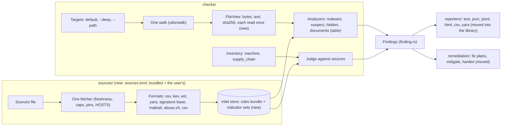

# wpantry's code reads like what it does, and its data sources plug in

## TL;DR

wpantry's library is 60-odd files side by side in `src/`. Each check walks the disk, reads files and fetches its own data, so a file can be read three or four times per scan, and every source is a constant in the code. This refactor groups the code by what it does (`sources/`, `checks/`, `reporters/`, `remediation/`, `utils/`, with core files at `src/`), puts every check that reads files on one walk, and moves every data source (advisories, YARA rules, indicators, hash lookups) into a TOML sources file that a user can extend. It starts after [#131](https://github.com/waffuruai/pantry/pull/131) and [#132](https://github.com/waffuruai/pantry/pull/132) merge.

## Architecture

Today: [docs/architecture.md](../docs/architecture.md). Every file's move is in [design/source-layout.md](design/source-layout.md); the sources file is in [design/sources-file.md](design/sources-file.md).

## Terms

| Term | Meaning here |
|---|---|
| Source | Anything wpantry reads from outside the machine: an advisory API (OSV), a list (KEV, Feodo), a rule set (YARA Forge), a lookup (CIRCL) |
| Sources file | `sources.toml`: the bundled one (`assets/defaults/`) plus the user's (`~/.config/wpantry/sources.toml` or `--sources FILE`) |
| Indicator | One value from an IOC list: a hash, host, IP, URL or file name, with its family and source |
| FileView | One file as every analyzer sees it: path, kind, and its bytes, text and sha256, each read or computed at most once |
| Analyzer | A check over a FileView (YARA, indicators, suspect code, hidden text, documents) |
| Tier | When a source is used: `default` (every scan), `deep` (`--deep` only) or `off` |

## What it is

A behaviour-neutral reorganisation first, then four changes it makes room for: one walk for every check that reads files, a sources file for every source (the CVE ones included), indicators matched by lookup rather than as YARA strings, and the reporters moved into the library.

**Not:** new checks; changes to the CLI contract beyond additive commands and flags; a crate split (the library stays one crate beside `wpantry-yara`); hosting user sources ourselves.

## Why

A reader should be able to tell what wpantry does from its tree. Today that takes reading files, and similar code (walkers, readers, fetchers, fix logic) is written several times. Repeated walks and reads make a machine with many repos slow (a full scan took 293 s on the owner's machine). Hard-coded sources mean adding a feed (stamparm's trails, an internal OSV mirror, a team's YARA rules) needs a release.

## Why now

#131 adds the malware scan's sources and walk in the same style, and #132 has just split posture into `os/behaviour` folders. Doing the rest now, before the download guard ([03](03-download-guard.md)) and the Watchdog reuse these parts, costs one round of moves instead of several.

## Acceptance criteria

### Functionality

- F1. The tree is the one in [design/source-layout.md](design/source-layout.md): `sources/`, `checks/`, `reporters/`, `remediation/`, `utils/`, and core files at `src/`; `breach` is `email`, `compare` is `checks/ecosystems`, `posture` is part of `checks/machine`. A test lists `src/` and fails on a file outside them. Evidence: `rust/crates/wpantry/tests/layout.rs`. Issue: #138.
- F2. The moves change no behaviour: the contract suite passes unchanged, and a scan of the test fixtures gives byte-identical `--json` before and after. Evidence: each phase-1 PR (#146, #147, #148 and 1d) compares the previous build's scan with its own, from copies of one warm cache. Issue: #138.
- F3. Every check that reads file contents (malware, suspect code, hidden text, documents) runs on one walk and one FileView per file; a counting test shows each file opened once per scan. Evidence: `checks/files/pass.rs` (`each_file_is_opened_once_whichever_checks_read_it`: one file read by five checks is opened once) and `checks/files/view.rs` (a repo program's first bytes and its contents come from one open). Issue: #138.
- F4. One per-file cache, keyed by (device, inode, size, mtime) and each analyzer's version, serves every analyzer, so an unchanged file is not re-read by any of them. Evidence: `checks/files/cache.rs` (one record per root; a check's version hashes its source, and the malware scan's adds the rules' hash) and `checks/files/pass.rs` (`an_unchanged_file_is_not_read_again`: a second pass opens nothing unchanged, a changed file is read again, a deleted one leaves the record). Issue: #138.
- F5. Every source is an entry in the bundled `sources.toml`, the CVE sources included: OSV, CISA KEV, endoflife.date, the release feeds, the distro advisories, deps.dev, OpenSSF malicious packages, the breach lookups, YARA Forge, signature-base, Feodo, YARAify, CIRCL and MalwareBazaar. No URL is a constant in the code. Evidence: `rust/crates/wpantry/assets/defaults/sources.toml` declares all 23 (21 over https, 2 by git); `sources/file.rs` reads it, every source's URL is `url("<id>")`, and `every_id_the_code_names_is_bundled` checks each id the code names. What is left as a constant is not a data source: wpantry's own release download, and links shown to people (the gitleaks install page, the eMudhra advisory). Issue: #138.
- F6. A user source in a supported format (YARA, an OSV-compatible API, a hash, host or file-name list) added to the user's `sources.toml` is fetched, checked and used with no code change; `wpantry sources [--json]` lists every source, its tier, host, licence, freshness and last error. Evidence: `sources/file.rs` (`merged`: what a user's source may be), `sources/user.rs` (asked about once, fetched into place), the OSV-compatible APIs asked beside OSV.dev (`osv.rs`, `another_osv_compatible_api_is_asked_the_same_way`), the user's hash lookups (`hash_lookups.rs`), the user's lists read with the bundled ones (`indicator_lists.rs`), and `wpantry sources [--json] [--sources FILE]` (contract `test_sources`). Issue: #138.
- F7. Indicators are matched by lookup: each file's hashes, and the hosts, IPs and URLs it names (ASCII or UTF-16), are extracted once and looked up in one store, so the number of indicators doesn't change the work per file. What a file holds is kept in the files cache, so a refreshed list is matched against every file without reading it again. Which lists a scan uses is each source's tier (`default`, or `deep` for `--deep` only). Evidence: `sources/indicator_store.rs` (one normaliser for a list's line and a file's token; an open-addressed table; saved and read back while its lists are unchanged, mutation-tested), `checks/malware/observe.rs` (the extraction, its keys kept in the files cache) and `checks/malware/indicators.rs` (one hit per list per file, naming the first match and how many more). signature-base's hashes and C2 hosts and Feodo Tracker's addresses moved from a generated YARA rule into the store; a scan of the test fixtures gives the same findings, the C2 one now naming its host. Maltrail's trails (1.6 million indicators) work as a source of the user's own (`kind = "indicators"`, `format = "maltrail-csv"`): end to end, a script naming a trails domain warns `IOC_Host_User_trails` with its family. Issue: #138.
- F8. Rules: a curated bundle built in a `pantry-rules` repo is embedded in each release (first scan works offline) and refreshed daily as a signed release asset; user and fetch-only sources merge on the machine, deduplicated by logic hash, ours first, each rule named `source:rule`. Evidence: not evidence yet. Issue: pending.
- F9. Reporters live in the library, one file per format, all rendering the same report from the cache: JSON (the contract's), JSON Lines, CSV, Markdown, HTML and YARA (`rules gen`'s rule text). The terminal's report is the CLI's (`wpantry-cli/src/tui.rs`), drawn from the same grouping (`reporters/view.rs`: areas, rows, the update plan's batches). `wpantry report` (alias `export`) renders the latest scan and never scans; `scan` and `fix` call it when they finish, with the same options. Evidence: `reporters/mod.rs` (`latest` rebuilds the scan from the cache: its findings, its counts in the order counted, its totals and scope; `the_latest_scan_reads_back_as_it_was`), `reporters/view.rs` (`areas_and_rows_come_in_fix_order`, `alike_commands_batch_and_sudo_stays_apart`), `reporters/yara.rs` (a generated rule written out, compiled strict and matched against its samples), the CLI's `tui_tests.rs`, and the contract suite (`report`, `export`, `scan --html -o`). On the test fixtures, `scan --json` is byte-identical to the previous build's, cold and warm, and `report --json` is byte-identical to the `scan --json` it follows. Issue: #138.
- F10. The default malware scan reads risky file types (programs and scripts by magic number or `#!` line, installers, disk images, archives, office documents, PDFs) anywhere under `~` except repos' sources, plus `/tmp`, `/var/tmp` and `/Users/Shared`; `--deep` reads every readable file under `/`; `--path` is documented as the way to scan anything else. Evidence: not evidence yet. Issue: pending.

### Performance

- P1. A second default scan with nothing changed finishes in under 20 s on the owner's machine (293 s first scan today), all of it from the per-file cache and the sources' freshness. Evidence: not met yet. On the owner's machine (339 repos, 1.45 million files, `--offline`), the full default scan with identical `--json` took 304 s before phase 2; after it, 142 s cold and 44–54 s warm. A repo-only scan of `~/Development` went from 275 s warm to 39–50 s. What remains on a warm scan is one `stat` per repo file (about 7 s across ten cores: the malware scan judges every repo file by its first bytes, so every file's identity is checked), listing `node_modules` for the dependency binaries (about 7 s, the largest repo alone), the lockfile, hook and image checks (about 10 s) and the cache's records (about 4 s). Phase 7's file-type scope (F10) takes most repo files out of the malware scan, which is where the rest of P1 comes from. Issue: #138.
- P2. Matching 1,000,000 indicators costs within 10% of matching 1,000 on the same files. Evidence: `p2_a_million_indicators_cost_what_a_thousand_do` (ignored by default; release build): 400 files of 64 KiB, each naming 2,000 hosts, read and matched in 1.49 s against 1,000 indicators and 1.61 s against 1,000,000 (1.08x); matched from the files cache, 26 ms and 92 ms. With the trails added, the store is built once per list update (about 3 s) and read back in well under a second; a warm scan's preparation took 1.46 s with 1.6 million indicators and 1.44 s without. Issue: #138.
- P3. The first default scan is no slower than today's, though it covers more of `~` (F10). Evidence: not evidence yet. Issue: pending.

### Security

- S1. Egress stays an allowlist. The hosts of the bundled sources are compiled in, and a test fails if the code and `sources.toml` disagree. A host from the user's sources file is used only to fetch that source, after a one-time yes, and is listed by `wpantry sources` and in the report. Evidence: `the_bundled_file_reads_and_its_hosts_are_the_allowlist` (`net::HOSTS` is the file's hosts), `a_new_host_is_used_only_after_a_yes_kept_by_id_and_url` and `a_users_host_is_allowed_only_once_allowed`; with `--no-input` and no stored yes the source is turned off and `unchecked` (shown end to end in the PR). Issue: #138.
- S2. Nothing the user's sources file says can make wpantry send data: a source that receives data (a hash lookup) needs its own consent, as the hash lookups do today, and sends only what the bundled ones send (a SHA-256). Evidence: `a_users_file_sets_tiers_and_adds_what_a_user_may_add`: only a hash lookup may send, only a SHA-256, under its own consent beside the hash-lookup consent; a bundled source's only setting is its tier. Issue: #138.
- S3. Fetched data is hostile input: every format's reader has size caps and is mutation-tested; a bundled source can be pinned to a sha256 or signature, and a pin that fails keeps the last good copy and reports the source `unchecked`. Evidence: `sources/mutate.rs`: every reader is served 96 seeded corruptions of a good answer (bits flipped, cut short, bytes inserted, deleted and repeated, other JSON, deep nesting, huge numbers) and must return, never panic, and keep its last good copy; `sources/fetch.rs` caps every answer at its `max_bytes` while reading and checks a `sha256` pin; a refused copy is recorded and never stored. In-tree mutation tests stand in for fuzz targets (no new dependency). Issue: #138.
- S4. A source marked fetch-only (GPL, unlicensed, ELv2) is never embedded or redistributed; the `pantry-rules` bundle carries a `NOTICE` and each rule's licence meta. Evidence: not evidence yet. Issue: pending.

## Phases

| Phase | Scope | Done when | Issue |
|---|---|---|---|
| 1 | Moves and renames, no behaviour change: `utils/` and core types, then `checks/`, then `sources/`, then `reporters/` and `remediation/`, then consolidation and the largest files split by behaviour (six PRs) | F1, F2 | done |
| 2 | One walk, FileView, the shared per-file cache, analyzer tables (`suspects/` rules as one `Rule` table), in five PRs: 2a FileView and the shared walk, 2b the files pass, 2c the cache, 2d the malware scan on it, 2e the rule table | F3, F4, P1 | F3, F4 done; P1 see its evidence |
| 3 | `sources.toml`, the fetcher, HOSTS from the file, `wpantry sources`, user sources with consent; every current source declared | F5, F6, S1–S3 | done: 3a the file and its URLs, 3b one fetcher and mutation tests, 3c `wpantry sources`, 3d the user's sources |
| 4 | Indicator store and lookup matching; trails and the tiers | F7, P2 | done: one store matched by lookup, each file's hashes and named hosts in the files cache, Maltrail's trails as a source of the user's own (#164 asks to ship them) |
| 5 | Reporters in the library; CSV and YARA added | F9 | done: `report` as the main command (alias `export`) with `--txt`, `--json`, `--jsonl`, `--csv`, `--md`, `--html`, `-o FILE`, `--history`; `scan` and `fix` call it; the shared grouping and fix batches; the TUI in the CLI; Markdown and YARA writers |
| 6 | `pantry-rules` repo, embedded snapshot, signed daily bundle | F8, S4 | pending |
| 7 | Default and `--deep` scope by file type | F10, P3 | pending |

Phases 2–7 depend on 1; 4 depends on 3; 6 depends on 3. Phase 7 can follow 2 directly.

## Blockers and decisions

**Blockers:** #131 and #132 merge first (both move files this refactor moves). Creating `waffuruai/pantry-rules` needs the owner's yes (phase 6).

**Open decisions:** none.

**Decision log:**

| Date | Decision | Why | Who |
|---|---|---|---|
| 2026-11-04 | Top-level `sources/`, `reporters/`, `utils/`, `remediation/`, `checks/` (with subfolders such as `ecosystems/`, `documents/`, `lockfiles/`); core files stay at `src/` | The tree should say what the code does; similar code sits together | Eric |
| 2026-11-04 | `breach` becomes `email` | Says what it checks | Eric |
| 2026-11-04 | The CVE sources join the sources file, not only the malware ones | One way to declare, inspect and replace any source | Eric |
| 2026-11-04 | The sources file is TOML, read by the in-tree TOML reader (`lockfiles/toml.rs`, moved to `utils/` and given integers, booleans and arrays) | Reads best for people; no new dependency | Eric |
| 2026-11-04 | Sources are config, but a user source's host needs a yes and can never receive data without its own consent | HOSTS is what lets pantry promise where it talks to | Eric |
| 2026-11-04 | Indicators are data matched by lookup, not YARA strings | Scales to millions of indicators | Eric |
| 2026-11-04 | Default malware scope by file type across `~`; `--deep` covers `/` | Catches things in odd places without reading every source file | Eric |
| 2026-11-04 | `posture/` merges into `machine/` (`any/`, `macos/`, `linux/`; `windows/` with its first check); `suspect/` becomes `suspects/`; `deps_dev` becomes `package_licenses`; `package_managers/` becomes `ecosystems/`, with one `Ecosystem` table | Machine inventory and settings are both "this machine"; plural folders; name a source by what it provides; one place knows each ecosystem | Eric |
| 2026-11-04 | The files cache is one record per root (files by folder, a 64-bit fingerprint of each file's identity, each check's result), not a row per file and check | A row per file and check was 2.2 GB for the owner's 339 repos; the record is under 200 MB and loads in one query | Eric |
| 2026-11-04 | A check's cache version is a hash of its own source (and the malware rules' hash), not a hand-bumped number | A changed check can never be served a result it didn't compute, release or dev build | Eric |
| 2026-11-04 | The malware rules are compiled before the files are read, so YARA runs on the files pass; a repo program's first bytes and contents come from one open | One read per file (F3) | Eric |
| 2026-11-04 | Hidden text stays one scanner rather than a rule table | Its checks share per-line state (right-to-left context, text addressed to an agent); suspect code's rules are independent and became the table | Eric |
| 2026-11-05 | Every source, the CVE ones included, is declared in `assets/defaults/sources.toml`; `net::HOSTS` stays compiled in and a test holds it to the file | One place says what wpantry talks to; the allowlist can't drift from it | Eric |
| 2026-11-05 | Hostile-input tests are in-tree, seeded mutation tests, not cargo-fuzz | No nightly toolchain or new dependency; runs in every `cargo test` | Eric |
| 2026-11-05 | A copy a reader refuses (or an empty one) never replaces the last good copy; with no good copy the source is `unchecked` | Found by the mutation tests: an empty answer used to wipe the KEV list and the cask catalog | Eric |
| 2026-11-05 | A user's OSV-compatible API is asked beside OSV.dev; turning `osv` off makes it a replacement | Both uses from one setting | Eric |
| 2026-11-05 | "jsonr" in the reporters list was JSON Lines (`jsonl`) | A typo | Eric |
| 2026-11-05 | Text rendering moves to `reporters/text.rs`; colour and the progress line stay in the CLI | The library returns the report; the terminal is the CLI's | Eric |
| 2026-11-05 | `rules gen`'s output is a reporter (`reporters/yara.rs`) | One place renders each output format | Eric |
| 2026-11-05 | Hashes, hosts, addresses and URLs live in one indicator store, matched by lookup; each file's hashes and named hosts are kept in the files cache | Scales to millions of indicators, and a daily list refresh (Feodo changes daily) no longer re-reads every file | Eric |
| 2026-11-05 | Maltrail's trails are a source of the user's own, not a bundled one, until their maintainers agree (#164) | Their licence (Maltrail Trails Community Data License 1.0) needs written permission to build them into something offered to others, and allows a feature that imports a user's own indicators | Eric |
| 2026-11-05 | Tiers are per source; F7's "families touched in the last 90 days" is dropped | The published trails carry no dates; a user marks a large list `deep` instead | Eric |
| 2026-11-05 | `wpantry report` is the main command: it renders the latest scan from the cache and never scans; `export` is its alias; the terminal's tables are the default and `--txt`, `--json`, `--jsonl`, `--csv`, `--md`, `--html` choose another format, `-o FILE` a file | One way to see a scan, in any format, any time after it | Eric |
| 2026-11-05 | `scan` and `fix` take the same report options and call `report` when they finish | Keeps scanning and reporting apart; `scan --json` is byte-identical to `report --json` | Eric |
| 2026-11-05 | `--history` adds the exposure, remediation and audit logs to any format, replacing `--exposure`, `--remediation` and `--audit` | One flag; the logs belong with the report | Eric |
| 2026-11-05 | The terminal report is a TUI in the CLI, drawn from a grouping in the library (`reporters/view.rs`) that Markdown uses too and the HTML page will; the CLI reads the library's types, not JSON | The library never decides anything about a terminal; an interactive review (#166) adds a cursor and approvals to the same model | Eric |
| 2026-11-05 | The generator returns a rule draft; `reporters/yara.rs` writes its text and `rulegen` checks it compiles | One place writes each output format; the YARA crate keeps the scoring | Eric |
| 2026-11-05 | The indicator store stays a file beside the lists for now; keeping every cached thing in the database is #167 | One change at a time | Eric |
