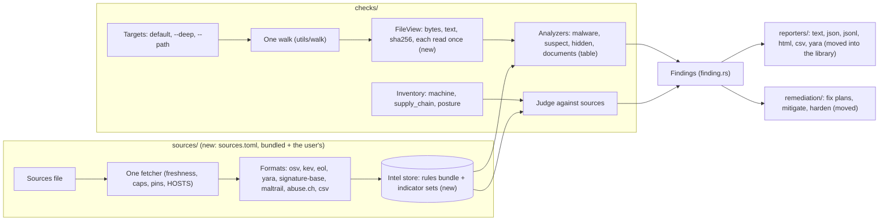

# wpantry's code reads like what it does, and its data sources plug in

## TL;DR

wpantry's library is 60-odd files side by side in `src/`. Each check walks the disk, reads files and fetches its own data, so a file can be read three or four times per scan, and every source is a constant in the code. This refactor groups the code by what it does (`sources/`, `checks/`, `reporters/`, `remediation/`, `utils/`, with core files at `src/`), puts every check that reads files on one walk, and moves every data source (advisories, YARA rules, indicators, hash lookups) into a TOML sources file that a user can extend. It starts after [#131](https://github.com/waffuruai/pantry/pull/131) and [#132](https://github.com/waffuruai/pantry/pull/132) merge.

## Architecture

Today: [docs/architecture.md](../docs/architecture.md). Every file's move is in [design/source-layout.md](design/source-layout.md); the sources file is in [design/sources-file.md](design/sources-file.md).

## Terms

| Term | Meaning here |
|---|---|
| Source | Anything wpantry reads from outside the machine: an advisory API (OSV), a list (KEV, Feodo), a rule set (YARA Forge), a lookup (CIRCL) |
| Sources file | `sources.toml`: the bundled one (`assets/defaults/`) plus the user's (`~/.config/wpantry/sources.toml` or `--sources FILE`) |
| Indicator | One value from an IOC list: a hash, host, IP, URL or file name, with its family and source |
| FileView | One file as every analyzer sees it: path, kind, and its bytes, text and sha256, each read or computed at most once |
| Analyzer | A check over a FileView (YARA, indicators, suspect code, hidden text, documents) |
| Tier | When a source is used: `default` (every scan), `deep` (`--deep` only) or `off` |

## What it is

A behaviour-neutral reorganisation first, then four changes it makes room for: one walk for every check that reads files, a sources file for every source (the CVE ones included), indicators matched by lookup rather than as YARA strings, and the reporters moved into the library.

**Not:** new checks; changes to the CLI contract beyond additive commands and flags; a crate split (the library stays one crate beside `wpantry-yara`); hosting user sources ourselves.

## Why

A reader should be able to tell what wpantry does from its tree. Today that takes reading files, and similar code (walkers, readers, fetchers, fix logic) is written several times. Repeated walks and reads make a machine with many repos slow (a full scan took 293 s on the owner's machine). Hard-coded sources mean adding a feed (stamparm's trails, an internal OSV mirror, a team's YARA rules) needs a release.

## Why now

#131 adds the malware scan's sources and walk in the same style, and #132 has just split posture into `os/behaviour` folders. Doing the rest now, before the download guard ([03](03-download-guard.md)) and the Watchdog reuse these parts, costs one round of moves instead of several.

## Acceptance criteria

### Functionality

- F1. The tree is the one in [design/source-layout.md](design/source-layout.md): `sources/`, `checks/`, `reporters/`, `remediation/`, `utils/`, and core files at `src/`; `breach` is `email`, `compare` is `checks/package_managers`. A test lists `src/` and fails on a file outside them. Evidence: not evidence yet. Issue: pending.
- F2. The moves change no behaviour: the contract suite passes unchanged, and a scan of the test fixtures gives byte-identical `--json` before and after. Evidence: not evidence yet. Issue: pending.
- F3. Every check that reads file contents (malware, suspect code, hidden text, documents) runs on one walk and one FileView per file; a counting test shows each file opened once per scan. Evidence: not evidence yet. Issue: pending.
- F4. One per-file cache, keyed by (device, inode, size, mtime) and each analyzer's version, serves every analyzer, so an unchanged file is not re-read by any of them. Evidence: not evidence yet. Issue: pending.
- F5. Every source is an entry in the bundled `sources.toml`, the CVE sources included: OSV, CISA KEV, endoflife.date, the release feeds, the distro advisories, deps.dev, OpenSSF malicious packages, the breach lookups, YARA Forge, signature-base, Feodo, YARAify, CIRCL and MalwareBazaar. No URL is a constant in the code. Evidence: not evidence yet. Issue: pending.
- F6. A user source in a supported format (YARA, an OSV-compatible API, a hash, host or file-name list) added to the user's `sources.toml` is fetched, checked and used with no code change; `wpantry sources [--json]` lists every source, its tier, host, licence, freshness and last error. Evidence: not evidence yet. Issue: pending.
- F7. Indicators are matched by lookup: a text file's hosts, IPs, URLs and hashes are extracted once and looked up in the store, so the number of indicators doesn't change the work per file. The default tier carries a curated, recent set (malware categories touched in the last 90 days); `--deep` uses the full lists. Evidence: not evidence yet. Issue: pending.
- F8. Rules: a curated bundle built in a `pantry-rules` repo is embedded in each release (first scan works offline) and refreshed daily as a signed release asset; user and fetch-only sources merge on the machine, deduplicated by logic hash, ours first, each rule named `source:rule`. Evidence: not evidence yet. Issue: pending.
- F9. Reporters live in the library, one file per format, all rendering the same report: text, JSON (the contract's), JSON Lines (today's export), HTML, CSV (new) and YARA (`rules gen`). The CLI only picks one and prints. Evidence: not evidence yet. Issue: pending.
- F10. The default malware scan reads risky file types (programs and scripts by magic number or `#!` line, installers, disk images, archives, office documents, PDFs) anywhere under `~` except repos' sources, plus `/tmp`, `/var/tmp` and `/Users/Shared`; `--deep` reads every readable file under `/`; `--path` is documented as the way to scan anything else. Evidence: not evidence yet. Issue: pending.

### Performance

- P1. A second default scan with nothing changed finishes in under 20 s on the owner's machine (293 s first scan today), all of it from the per-file cache and the sources' freshness. Evidence: not evidence yet. Issue: pending.
- P2. Matching 1,000,000 indicators costs within 10% of matching 1,000 on the same files. Evidence: not evidence yet. Issue: pending.
- P3. The first default scan is no slower than today's, though it covers more of `~` (F10). Evidence: not evidence yet. Issue: pending.

### Security

- S1. Egress stays an allowlist. The hosts of the bundled sources are compiled in, and a test fails if the code and `sources.toml` disagree. A host from the user's sources file is used only to fetch that source, after a one-time yes, and is listed by `wpantry sources` and in the report. Evidence: not evidence yet. Issue: pending.
- S2. Nothing the user's sources file says can make wpantry send data: a source that receives data (a hash lookup) needs its own consent, as the hash lookups do today, and sends only what the bundled ones send (a SHA-256). Evidence: not evidence yet. Issue: pending.
- S3. Fetched data is hostile input: every format's reader has size caps and a fuzz target; a bundled source can be pinned to a sha256 or signature, and a pin that fails keeps the last good copy and reports the source `unchecked`. Evidence: not evidence yet. Issue: pending.
- S4. A source marked fetch-only (GPL, unlicensed, ELv2) is never embedded or redistributed; the `pantry-rules` bundle carries a `NOTICE` and each rule's licence meta. Evidence: not evidence yet. Issue: pending.

## Phases

| Phase | Scope | Done when | Issue |
|---|---|---|---|
| 1 | Moves and renames, no behaviour change: `utils/` and core types, then `checks/`, then `reporters/` and `remediation/` (three PRs) | F1, F2 | pending |
| 2 | One walk, FileView, the shared per-file cache, analyzer tables (`suspect/` rules as one `Rule` table) | F3, F4, P1 | pending |
| 3 | `sources.toml`, the fetcher, HOSTS from the file, `wpantry sources`, user sources with consent; every current source declared | F5, F6, S1–S3 | pending |
| 4 | Indicator store and lookup matching; trails and the tiers | F7, P2 | pending |
| 5 | Reporters in the library; CSV and YARA added | F9 | pending |
| 6 | `pantry-rules` repo, embedded snapshot, signed daily bundle | F8, S4 | pending |
| 7 | Default and `--deep` scope by file type | F10, P3 | pending |

Phases 2–7 depend on 1; 4 depends on 3; 6 depends on 3. Phase 7 can follow 2 directly.

## Blockers and decisions

**Blockers:** #131 and #132 merge first (both move files this refactor moves). Creating `waffuruai/pantry-rules` needs the owner's yes (phase 6).

**Open decisions:**
1. "jsonr" in the reporters list: read here as JSON Lines (today's `export --jsonl`). Confirm, or name the format.
2. Text output: rendering moves to `reporters/text.rs`; colour and the progress line stay in the CLI. Confirm.
3. Is `rules gen`'s output a reporter (`reporters/yara.rs`, as listed), or does it stay a command beside `rules`?

**Decision log:**

| Date | Decision | Why | Who |
|---|---|---|---|
| 2026-11-04 | Top-level `sources/`, `reporters/`, `utils/`, `remediation/`, `checks/` (with subfolders such as `package_managers/`, `documents/`, `lockfiles/`); core files stay at `src/` | The tree should say what the code does; similar code sits together | Eric |
| 2026-11-04 | `breach` becomes `email` | Says what it checks | Eric |
| 2026-11-04 | The CVE sources join the sources file, not only the malware ones | One way to declare, inspect and replace any source | Eric |
| 2026-11-04 | The sources file is TOML, read by the in-tree TOML reader (`lockfiles/toml.rs`, moved to `utils/` and given integers, booleans and arrays) | Reads best for people; no new dependency | Eric |
| 2026-11-04 | Sources are config, but a user source's host needs a yes and can never receive data without its own consent | HOSTS is what lets pantry promise where it talks to | Eric |
| 2026-11-04 | Indicators are data matched by lookup, not YARA strings | Scales to millions of indicators | Eric |
| 2026-11-04 | Default malware scope by file type across `~`; `--deep` covers `/` | Catches things in odd places without reading every source file | Eric |
